<h1 align="center">Sony Cam Viewer</h1>

<p align="center">
  <b>Живое видео с камеры Sony и пульт к ней — на Android-планшете и на Mac.</b><br>
  По кабелю USB-C или по Wi-Fi. Открыл — сразу картинка, основные настройки в одно касание.
</p>

<p align="center">
  <a href="https://github.com/Scryptor/SonyCamViewer/releases/latest"></a>
  
  
</p>

<p align="center">
  <a href="https://github.com/Scryptor/SonyCamViewer/releases/latest/download/Sony-Cam-Viewer.apk"><b>⬇ Скачать для Android (APK)</b></a>
  &nbsp;·&nbsp;
  <a href="https://github.com/Scryptor/SonyCamViewer/releases/latest/download/Sony-Cam-Viewer.dmg"><b>⬇ Скачать для Mac (DMG)</b></a>
</p>

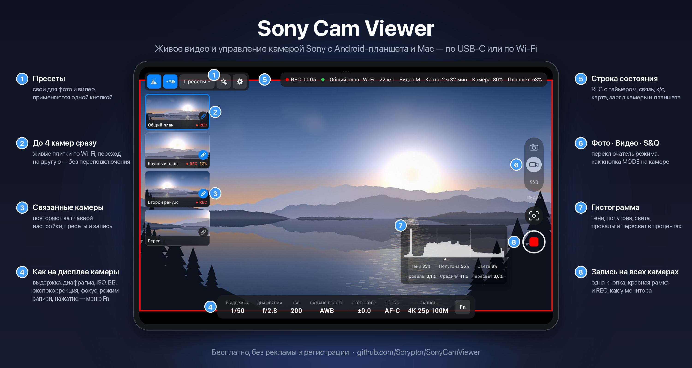

Замена Imaging Edge Desktop (Remote) без лишнего. Сделано и проверено на ZV-E10, но подходит и для других камер Sony — см. [Какие камеры подойдут](#какие-камеры-подойдут). Бесплатно, без рекламы и регистрации.

## Главное

- 📺 **Живое видео на весь экран** до 25 кадров в секунду — по USB-C, по Wi-Fi через роутер или напрямую (Wi-Fi Direct). Слабый сигнал программа переживает без разрыва.
- 🎛 **Настройки как на дисплее камеры**: выдержка, диафрагма, ISO, баланс белого, экспокоррекция, фокус, режим записи. Касание — меню Fn поверх кадра, плюс «Все настройки» по группам.
- 🔴 **Запись видео и фото** со спуском и автофокусом. REC с таймером и красная рамка вокруг кадра, снимки — на планшет, Mac или карту.
- 🎥 **До 4 камер сразу**: главная на большом экране, остальные — живыми плитками. Переключение мгновенное, даже во время записи.
- 🔗 **Связанные камеры** повторяют за главной настройки, пресеты и запись — одна кнопка на все.
- ⭐ **Пресеты** отдельно для фото и видео — свои настройки одной кнопкой.
- 📊 **Гистограмма**, цифровое увеличение до 8× для фокуса, галерея снимков с проверкой резкости.
- 🧩 Без драйверов, root и сторонних библиотек. Код открыт.

## Как начать

1. **Скачайте** программу: [APK для Android](https://github.com/Scryptor/SonyCamViewer/releases/latest/download/Sony-Cam-Viewer.apk) или [DMG для Mac](https://github.com/Scryptor/SonyCamViewer/releases/latest/download/Sony-Cam-Viewer.dmg) — подробнее в [Установке на Mac](#установка-на-mac) и [на Android](#установка-на-android).
2. **На камере** один раз включите PC Remote: MENU → Network → PC Remote Function → PC Remote: **On** — см. [Настройку камеры](#настройка-камеры).
3. **Подключите** камеру кабелем USB-C — через несколько секунд появится картинка. Или [по Wi-Fi](#подключение-по-wi-fi) — без кабеля.

<p align="center">
  <a href="#скачать">Скачать</a> ·
  <a href="#какие-камеры-подойдут">Камеры</a> ·
  <a href="#установка-на-android">Android</a> ·
  <a href="#установка-на-mac">Mac</a> ·
  <a href="#настройка-камеры">Настройка камеры</a> ·
  <a href="#подключение-по-wi-fi">Wi-Fi</a> ·
  <a href="#управление">Управление</a> ·
  <a href="#ограничения">Ограничения</a> ·
  <a href="#сборка-из-исходников">Сборка</a>
</p>

## Скачать

| | Mac | Android |
|---|---|---|
| **Файл** | [Sony-Cam-Viewer.dmg](https://github.com/Scryptor/SonyCamViewer/releases/latest/download/Sony-Cam-Viewer.dmg) | [Sony-Cam-Viewer.apk](https://github.com/Scryptor/SonyCamViewer/releases/latest/download/Sony-Cam-Viewer.apk) |
| **Что нужно** | Mac на Apple Silicon, macOS 14 или новее | Android 10 или новее, планшет или телефон с USB OTG |
| **Камера подключается** | кабелем USB-C или по Wi-Fi через домашний роутер | кабелем USB-C или по Wi-Fi через домашний роутер |
| **Как поставить** | [Установка на Mac](#установка-на-mac) | [Установка на Android](#установка-на-android) |

Все версии — на странице [Releases](https://github.com/Scryptor/SonyCamViewer/releases).

**Документация:** [руководство пользователя](docs/user-guide.md) · [протокол камеры](docs/protocol.md) · [устройство кода](docs/architecture.md) · [API автоматизации](docs/automation-api.md)

## Как это выглядит

| Mac | Android-планшет |
|---|---|
| 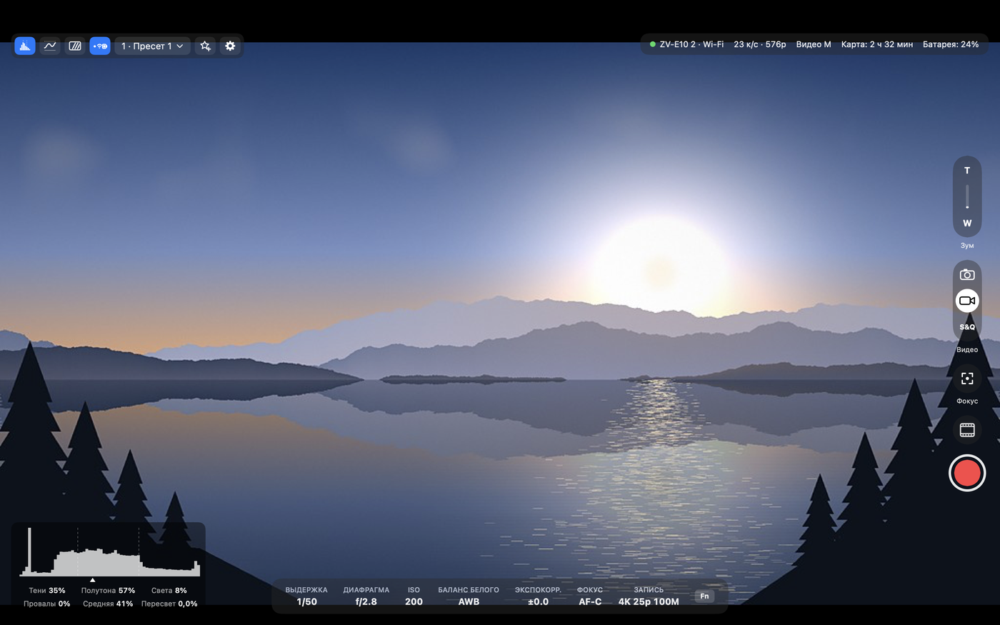 | 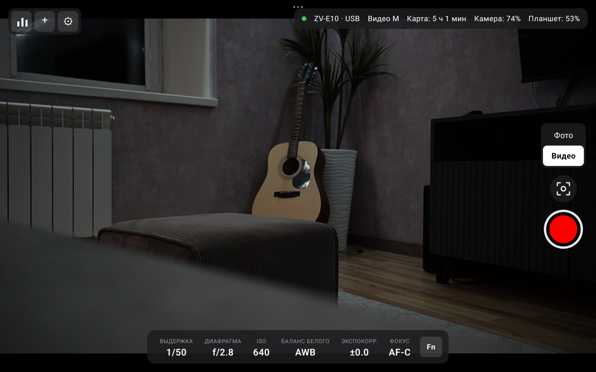 |

| Меню Fn на Mac | Меню Fn на Android |
|---|---|
| 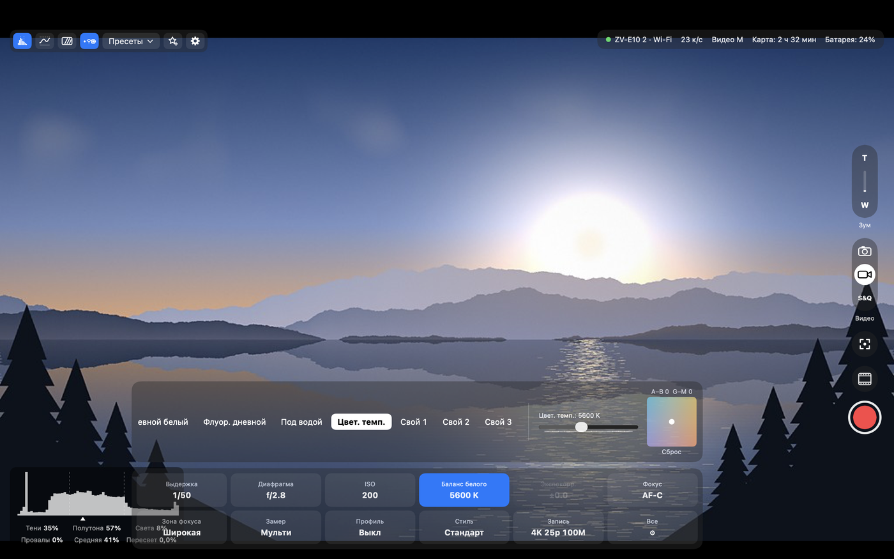 | 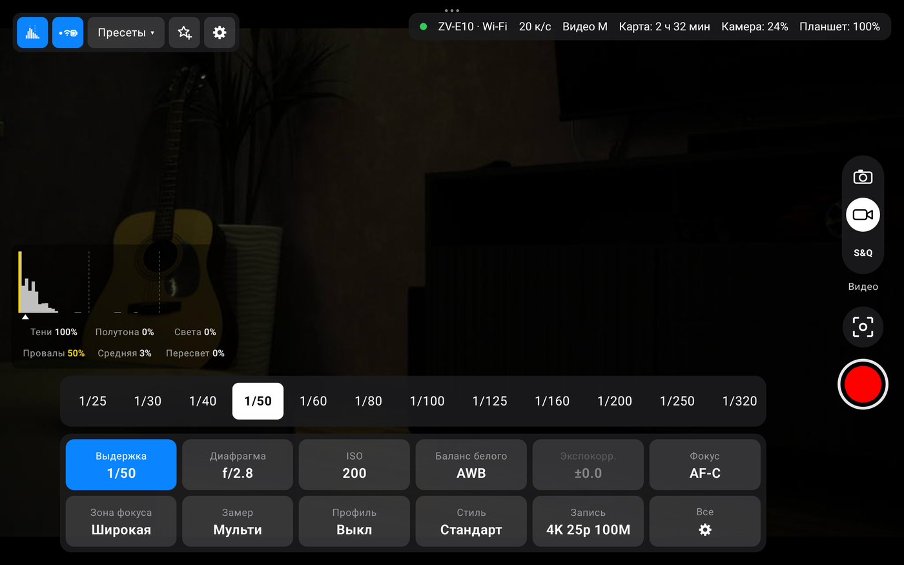 |

| Лента камер и группа на Mac | Лента камер и запись на планшете |
|---|---|
| 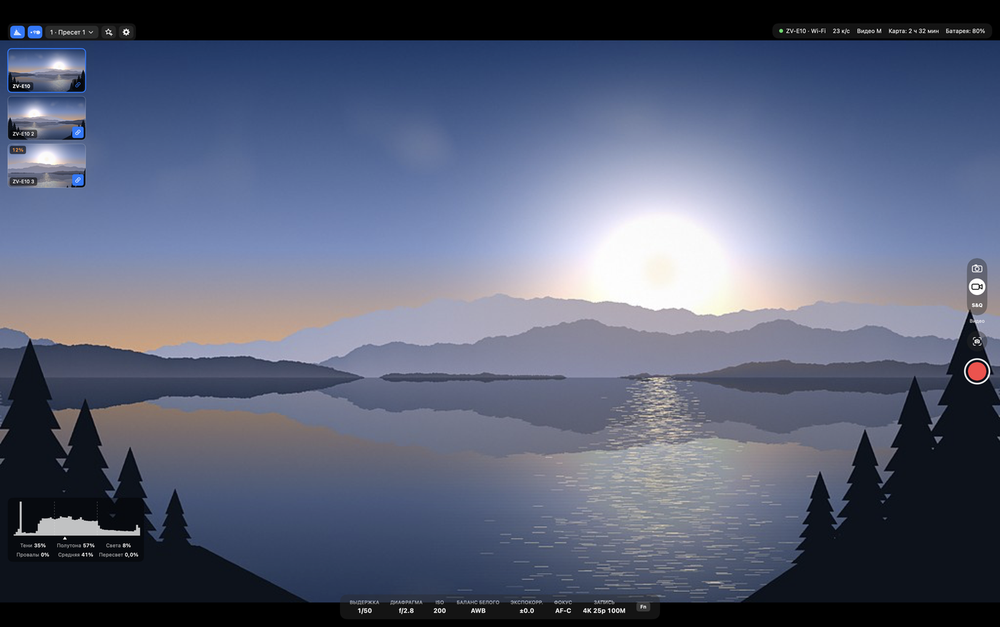 | 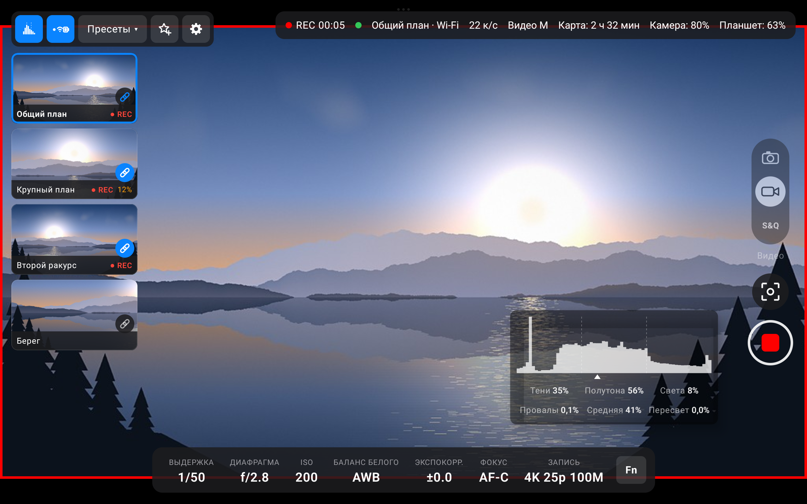 |

| Экран ожидания на Mac | Экран ожидания на планшете |
|---|---|
| 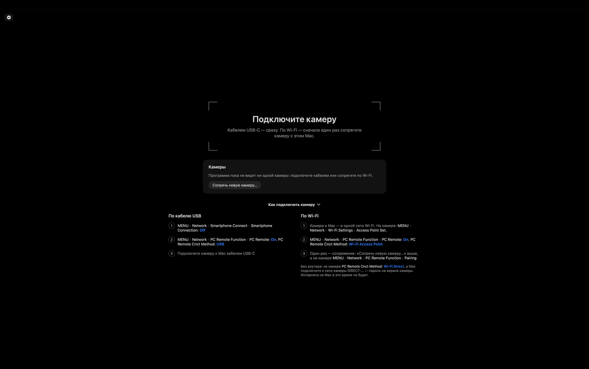 | 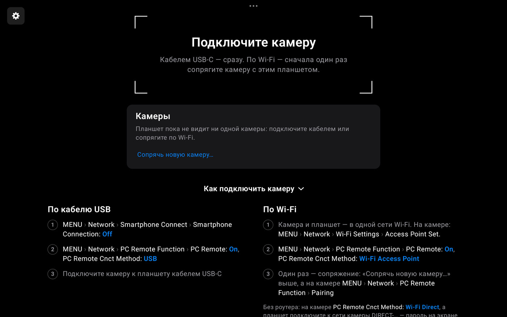 |

| Все настройки | Фоторежим |
|---|---|
| 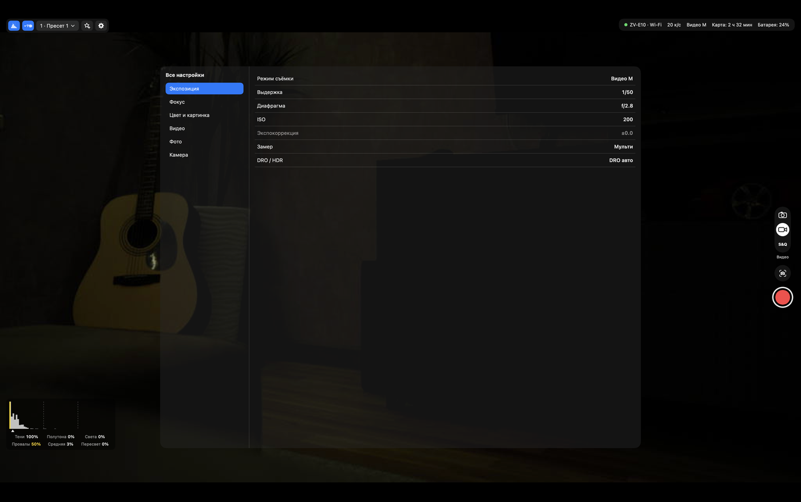 | 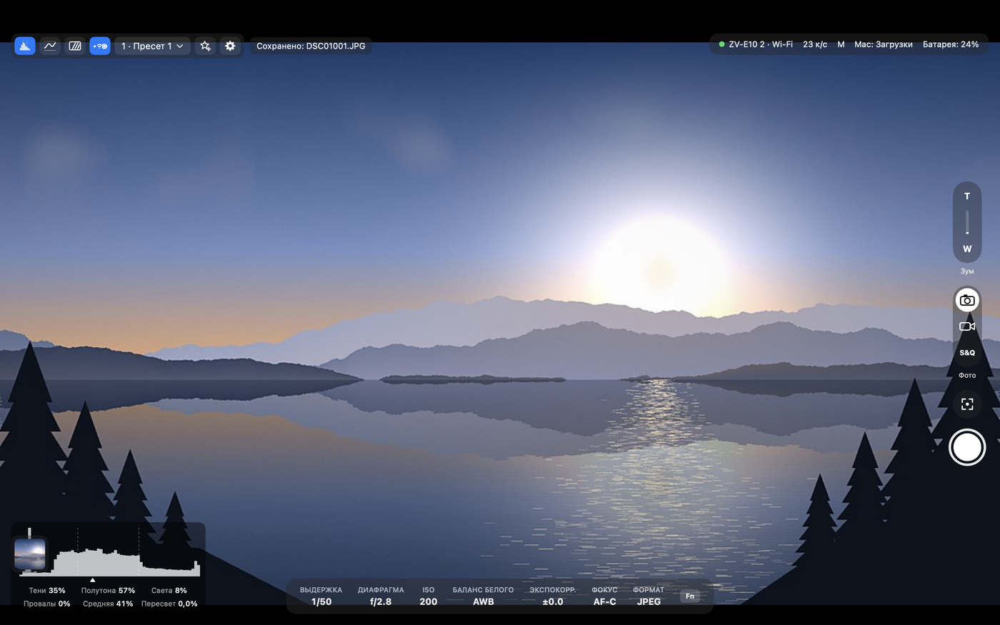 |

| Просмотр после съёмки | Пресеты на планшете |
|---|---|
| 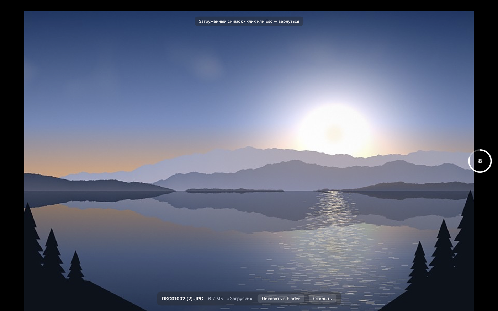 | 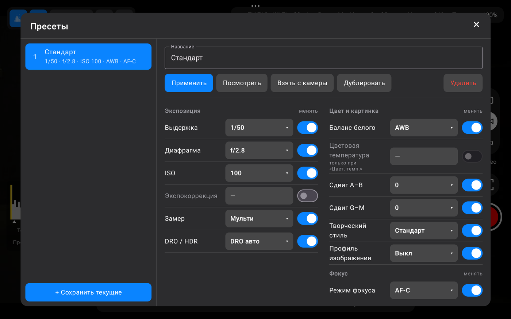 |

На скриншотах — виртуальная камера из `scripts/fake_camera.py`. В её видоискателе нарисованное кодом горное озеро, а не съёмка настоящей камеры.

## Что умеет


На Mac и на Android одно и то же:

<details>
<summary><b>Все возможности подробно</b> — нажмите, чтобы раскрыть</summary>

- **Сама находит камеру** — по кабелю USB или по Wi-Fi в домашней сети — и показывает живое видео на весь экран, до 25 кадров в секунду. Отключили кабель — подключается по Wi-Fi или ждёт камеру. См. [Подключение по Wi-Fi](#подключение-по-wi-fi).
- **Несколько камер.**
  - Программа помнит каждую камеру, к которой подключалась, и видит те, что на кабеле или в сети.
  - Список камер открывается щелчком по имени камеры в строке состояния; он есть и на экране ожидания. В нём можно подключить другую камеру, сопрячь новую, дать камере своё имя или забыть её.
  - Несколько камер по Wi-Fi держатся на связи сразу. Главная — на большом экране, остальные — живыми плитками в ленте слева.
  - Щелчок по плитке делает камеру главной мгновенно, без переподключения, в том числе во время записи. Плитки при этом не прыгают, а переставляют их перетаскиванием.
  - Цепочка на плитке связывает камеру с главной. Связанные камеры повторяют за ней настройки, пресеты и запись — одной кнопкой на все камеры.
  - После перезапуска — та же главная, та же лента, тот же порядок и те же связи.
- **Экран ожидания** — пока камеры нет.
  - В рамке фокуса написано, что программа делает и что сделать вам. Сразу под ней — список камер с «Подключить» и «Сопрячь».
  - Шаги подключения по кабелю и по Wi-Fi раскрыты при первом запуске, а потом свёрнуты.
  - Если Wi-Fi выключен в настройках, «Включить Wi-Fi» прямо на этом экране.
- **Отладка** — ⌥⌘D на Mac или долгое нажатие на строку состояния на планшете: панель по вкладкам со всем, что программа знает о связи (сигнал, отклик камеры, поток, провалы и восстановления), превью, камере и всех её свойствах, плюс журнал событий; «Скопировать» отдаёт всё текстом.
- **Строка состояния**: камера и способ связи, счётчик кадров, заряд. Видна вместе с остальными элементами, а вторая кнопка вверху слева закрепляет её — тогда она остаётся на экране и когда элементы спрятаны. Нажатие на имя камеры («ZV-E10 · Wi-Fi») показывает список камер, прошивку, адреса камеры и устройства и уровень сигнала; нажатие на счётчик объясняет, что это кадры трансляции, а не записи, и показывает самую долгую паузу между кадрами.
- **Строка значений внизу**, как на дисплее камеры: выдержка, диафрагма, ISO, баланс белого, экспокоррекция, фокус, в видеорежиме — режим записи («4K 25p 100M»), в фоторежиме — формат снимка. Нажатие на значение открывает меню Fn поверх кадра.
- **Фото, видео и S&Q** (замедленная и ускоренная съёмка) — переключатель справа, три значка в капсуле, делает то же, что кнопка MODE на камере. В S&Q в строке состояния видно частоту съёмки и замедление, например «100 к/с · ×4 замедл.». Саму частоту съёмки (1–100 к/с) камера по кабелю менять не даёт: она в меню камеры.
- **Режим записи одним выбором**: формат, частота и битрейт вместе — 4K 25p 100M, HD 100p 100M, HD 50p 50M и так далее. 100p есть только в HD, программа сама переключит формат видео.
- **Меню Fn**: сетка 2×6, как на камере, — 11 настроек и вход во все остальные. Для баланса белого есть цветовая температура и площадка сдвига A–B / G–M. Ползунок температуры работает в любом режиме: сдвинули — камера переходит на ручную температуру.
- **«Все настройки»** по группам: экспозиция, фокус, цвет и картинка, видео, фото, камера.
- **Запись видео** кнопкой. Пока идёт запись, видна метка REC с таймером и красная рамка вокруг картинки, как у мониторов; рамку можно выключить, сделать толще или тоньше, бледнее и мигающей.
- **Отклик на кнопки съёмки.** Палец закрывает кнопку, поэтому отклик — вокруг неё и на кадре: кольцо и волна, затемнение в момент спуска, стоп-кадр улетает в ленту. Пока камера занята, на кнопке дуга, слева подпись: «Фокусировка…», «Загрузка 42 %», «Запуск записи…». На Android — ещё и вибрация, если у устройства есть мотор.
- **Фоторежим.** Переключатель «Фото / Видео / S&Q» справа. Спуск с автофокусом. Снимки сохраняются на Mac или планшет, на карту или туда и туда. При RAW+JPEG скачиваются оба файла.
- **Просмотр после съёмки**: снимок показывается 1–10 секунд, можно выключить. На выбор — скачанный файл или кадр с камеры.
- **Стоп-кадр из видео**, запись при этом не прерывается.
- **Лента последних снимков и галерея**: листание (смахивание, стрелки), лента всех снимков сеанса, увеличение снимка с догрузкой полного разрешения — проверить резкость.
- **Цифровое увеличение live view** двумя пальцами (на Mac — щипок на трекпаде и ⌘= / ⌘− / ⌘0), до 8×, с мини-картой, множителем и кнопкой отмены. Камера о нём не знает. Видимая часть пересчитывается бикубически, а превью по Wi-Fi держится в полном размере до последнего.
- **Гистограмма** — отдельной кнопкой; её можно перетащить куда угодно, и она не прячется вместе с остальными элементами. Шкала поделена на трети, под графиком доли теней, полутонов и светов, провалы в чёрное, средняя яркость и пересвет. Пересвет и провалы от 1 % подсвечиваются жёлтым.
- **Пресеты** — свои у фото и у видео: сохранить настройки под своим именем и вернуть их одной кнопкой. В списке видно, что ставит каждый пресет и какой стоит сейчас. Поменяли что-то на камере после пресета — на кнопке оранжевая точка, а «Сохранить в «…»» записывает изменения в него; «Новый пресет…» делает новый. В окне пресетов можно поправить любое значение, порядок и то, что пресет меняет, а «Посмотреть» показывает пресет на камере, пока кнопку держат, — отпустили, и всё как было.
- **Элементы управления прячутся** сами (через 1–30 секунд, задаётся в настройках) или по команде.
- Без драйверов и сторонних библиотек: на Mac — системные ImageCaptureCore и Network, на Android — системный USB host и обычные сокеты.

</details>

## Какие камеры подойдут

Программа сделана и проверена на ZV-E10, но к этой модели не привязана: она подключается к любой камере Sony, у которой есть режим PC Remote по USB или по Wi-Fi. Насколько она заработает, зависит от поколения камеры.

| | Камеры | Что будет работать |
|:---:|---|---|
| ✅ | **ZV-E10** (прошивка 2.00) | всё — проверено |
| 🟢 | **Sony примерно с 2020 года**: a7S III, a7C, a7 IV, a7R V, a1, a9 III, FX3, a6700 и другие | не проверялось, но, скорее всего, всё: у них та же версия протокола, что у ZV-E10. Возможные отличия: часть значений будет подписана как `#N`; на камерах с колесом режимов может не работать переключатель «Фото / Видео / S&Q»; пункты меню для включения PC Remote лежат в других разделах |
| 🟡 | **Sony до 2020 года**: a6000, a6400, a6600, a7 III, a7R III, RX100 VI и другие | не проверялось. Может подключиться и показать видео, но выдержку, ISO и экспокоррекцию такие камеры меняют шагами «+1 / −1», а программа пишет значения напрямую, поэтому их изменение, скорее всего, не заработает |
| ❌ | **Canon, Nikon, Fujifilm, Panasonic** и другие | нет: у них свои протоколы, программа ищет только камеры Sony |

> [!TIP]
> Попробовать на другой камере Sony безопасно: при подключении программа только передаёт управление компьютеру и не трогает настройки, пока вы сами их не поменяете. Если попробовали — расскажите в [Issues](https://github.com/Scryptor/SonyCamViewer/issues), что работает, а что нет.

## Установка на Android

Нужен Android 10 или новее и планшет или телефон, к которому по USB можно подключать устройства (USB host, OTG): это умеет почти любой современный. Проверено на Redmi Pad Pro с Android 14.

1. Скачайте [Sony-Cam-Viewer.apk](https://github.com/Scryptor/SonyCamViewer/releases/latest/download/Sony-Cam-Viewer.apk) прямо на планшет и откройте его. Android попросит разрешить установку из этого источника — разрешите.
2. [Настройте камеру](#настройка-камеры) и подключите её к планшету кабелем USB-C.
3. Android спросит, дать ли программе доступ к камере, — нажмите «ОК». Если в окне есть галочка «всегда открывать при подключении» — отметьте её: тогда программа будет запускаться сама, как только вы подключите камеру.

Снимки и стоп-кадры сохраняются в «Загрузки/ZV-E10» и видны в галерее.

> [!TIP]
> Разъём у планшета один, поэтому, пока подключена камера, он работает от батареи. Заряжать его одновременно можно через USB-C-хаб с проходной зарядкой — или подключить камеру [по Wi-Fi](#подключение-по-wi-fi). Заряд и камеры, и планшета виден в строке состояния.

## Установка на Mac

Нужен Mac на Apple Silicon и macOS 14 или новее.

1. Скачайте [Sony-Cam-Viewer.dmg](https://github.com/Scryptor/SonyCamViewer/releases/latest/download/Sony-Cam-Viewer.dmg).
2. Откройте его и перетащите «Sony Cam Viewer» в «Программы».
3. Откройте программу в первый раз — см. ниже.
4. [Настройте камеру](#настройка-камеры) и подключите её к Mac кабелем USB-C.

> [!IMPORTANT]
> Программа не подписана сертификатом разработчика Apple, поэтому при первом запуске macOS её не откроет. Чтобы открыть:
> 1. попробуйте запустить программу и закройте предупреждение;
> 2. откройте «Системные настройки» → «Конфиденциальность и безопасность», внизу нажмите «Всё равно открыть».
>
> Или одной командой в Терминале:
>
> ```bash
> xattr -dr com.apple.quarantine "/Applications/Sony Cam Viewer.app"
> ```

> [!NOTE]
> - При первом снимке в папку «Загрузки» macOS может спросить разрешение на доступ к ней: разрешите.
> - До версии 0.5.1 программа называлась ZV-E10 Viewer: если она стоит, после установки удалите её — настройки и пресеты у них общие и сохранятся.

## Настройка камеры

Один раз на камере:

| | Пункт меню | Значение |
|:---:|---|---|
| 1 | MENU → Network → Smartphone Connect → Smartphone Connection | **Off** |
| 2 | MENU → Network → PC Remote Function → PC Remote | **On** |
| 3 | MENU → Network → PC Remote Function → PC Remote Cnct Method | **USB** |

Потом подключите камеру кабелем USB-C к Mac или к планшету. Через несколько секунд появится картинка.

Пункты меню — для ZV-E10. На других камерах Sony они называются похоже, но могут лежать в других разделах меню.

> [!NOTE]
> На Mac после установки и после каждого обновления macOS спросит, можно ли программе читать «файлы на съемном томе», — нажмите «Разрешить». Без этого macOS не отдаёт программе камеру; программа подскажет это на экране ожидания.

> [!TIP]
> Камера подключена, но картинки нет? Закройте Imaging Edge и другие программы, которые могли занять камеру, и переподключите кабель.

## Подключение по Wi-Fi

Без кабеля программа находит камеру сама — в домашней сети или в сети, которую раздаёт камера.

### Через домашний роутер

Один раз:

1. На камере: MENU → Network → Wi-Fi Settings → Access Point Set. — подключите камеру к домашнему роутеру. ZV-E10 работает только в диапазоне 2,4 ГГц, Mac или планшет могут быть в той же сети в любом диапазоне.
2. MENU → Network → PC Remote Function → PC Remote: **On**, PC Remote Cnct Method: **Wi-Fi Access Point**.
3. Запустите программу без кабеля и на экране ожидания нажмите «Сопрячь новую камеру…» под списком камер.
4. На камере: MENU → Network → PC Remote Function → **Pairing** и подтвердите.

Дальше программа подключается сама, как только камера появится в сети.

- Mac и планшет сопрягаются по отдельности, камера помнит оба, но подключено может быть только одно устройство сразу.
- Если камера на кабеле в режиме PC Remote по USB, связь идёт по USB, а уже идущую связь по Wi-Fi кабель (например, зарядка) не рвёт.
- Камер в сети несколько — каждая сопрягается один раз, а какую подключать, выбирают в списке камер.
- «Забыть сопряжение» в настройках — у программы новое имя для камер: все камеры придётся сопрячь заново.
- На Mac при первом подключении разрешите программе доступ к локальной сети.

### Без роутера (Wi-Fi Direct)

Например, на улице: камера сама раздаёт сеть.

1. На камере: PC Remote Cnct Method: **Wi-Fi Direct**. Камера покажет имя своей сети (`DIRECT-…`) и пароль.
2. Подключите планшет или Mac к этой сети. Android предупредит, что в ней нет интернета, — останьтесь подключёнными.
3. Программа найдёт камеру сама, в строке состояния будет «Wi-Fi Direct».

Проверено на планшете: превью 23–25 кадров в секунду, RAW+JPEG — около 20 секунд. Планшет, уже сопряжённый через роутер, подключился без нового сопряжения. Mac, подключённый к сети камеры, на это время остаётся без интернета.

### Скорость и слабый сигнал

| | По кабелю | По Wi-Fi |
|---|---|---|
| Превью | до 25 к/с | до 25 к/с |
| RAW+JPEG, от нажатия до файла | около 4 с | около 14 с на планшете, 12–14 с на Mac |
| Батарея камеры | — | садится быстрее |

Замирание связи программа пережидает, не разрывая подключение: последний кадр остаётся на экране, сверху — «Слабый сигнал Wi-Fi», а если связи нет дольше пары секунд — «Связь с камерой прервалась» и сколько это длится. Связь вернулась — картинка идёт дальше сама. Если подключение всё же оборвалось, программа сразу подключается заново (обычно за 1–2 секунды), кадр и настройки остаются на экране.

Полное качество превью — около 14 Мбит/с, это почти потолок Wi-Fi камеры, поэтому при слабом сигнале программа сама переходит на 640×360 (в строке состояния — «360p»): картинка мельче, но идёт плавно, а при хорошем сигнале возвращается полное качество. Выключается в настройках.

## Управление

### На Android

| Жест | Что делает |
|---|---|
| Касание видео | спрятать или вернуть элементы управления; без касаний они прячутся сами, через сколько секунд — задаётся в настройках |
| Касание значения внизу | меню Fn; значения меняются касанием, ленту значений можно листать пальцем |
| Два пальца на видео | цифровое увеличение до 8×; ✕ в правом нижнем углу возвращает весь кадр |
| Касание плитки камеры | сделать камеру главной |
| Долгое нажатие на плитку | меню камеры; если после него повести пальцем — плитка поменяет место |
| Касание снимка в ленте | галерея: листать смахиванием, увеличивать щипком или двойным касанием, закрыть смахиванием вниз или «Назад» |
| Долгое нажатие на снимок | открыть файл в другой программе |
| Долгое нажатие на «Пресеты» | панель «Пресеты», где их правят |
| Перетаскивание гистограммы | поставить её куда угодно |
| Долгое нажатие на строку состояния | панель отладки |

- **Пресеты** — кнопка вверху слева, у фото и у видео свои: касание открывает список, ☆+ сохраняет настройки — в текущий пресет или новым.
- **Строка состояния** видна вместе с остальными элементами, а вторая кнопка вверху слева закрепляет её: пока кнопка горит синим (так по умолчанию), строка остаётся на экране и когда элементы спрятаны.
- **Вибрация**: если у устройства есть вибромотор, кнопки съёмки отвечают вибрацией (выключается в настройках). У Redmi Pad Pro мотора нет — там отклик только на экране.
- **Настройки** — кнопка ⚙ вверху слева: куда сохранять снимки (на планшет и на карту, только на планшет, только на карту), сколько секунд и что показывать после съёмки, красная рамка во время записи, подключаться ли по Wi-Fi, прятать ли элементы управления и через сколько секунд.

### На Mac

| Клавиша | Что делает |
|---|---|
| <kbd>F</kbd> | открыть или закрыть меню Fn |
| <kbd>←</kbd> <kbd>→</kbd> | изменить выбранную настройку в меню Fn; в галерее — соседний снимок |
| <kbd>1</kbd>–<kbd>9</kbd> | применить пресет |
| <kbd>⇧</kbd><kbd>⌘</kbd><kbd>P</kbd> | окно пресетов |
| <kbd>Пробел</kbd> | снимок в фоторежиме; закрыть просмотр снимка или галерею |
| <kbd>S</kbd> | стоп-кадр в видеорежиме |
| <kbd>H</kbd> | скрыть или показать элементы управления |
| <kbd>Esc</kbd> | закрыть меню, просмотр или галерею |
| <kbd>⌘</kbd><kbd>=</kbd> <kbd>⌘</kbd><kbd>−</kbd> <kbd>⌘</kbd><kbd>0</kbd> | увеличить или уменьшить картинку, вернуть весь кадр |
| <kbd>⌥</kbd><kbd>⌘</kbd><kbd>D</kbd> | панель отладки |
| <kbd>⌘</kbd><kbd>,</kbd> | настройки программы |

Буквы работают и в русской раскладке (F/А, S/Ы, H/Р).

- **Мышь и трекпад.** Колесо мыши над меню Fn листает значения выбранной настройки. Щипок на трекпаде увеличивает картинку. Гистограмму можно утащить мышью куда угодно.
- **Лента камер.** Щелчок по плитке делает камеру главной, перетаскивание меняет место.
- **Пресеты** — кнопка вверху слева, у фото и у видео свои: клик открывает список, где видно, что ставит каждый пресет, ☆+ сохраняет настройки — в текущий пресет, если его поменяли на камере, или новым, а «Вид → Пресеты…» (<kbd>⇧</kbd><kbd>⌘</kbd><kbd>P</kbd>) открывает окно, где пресеты переименовывают, переставляют и правят по одной настройке.
- **Снимки.** Клик по снимку в ленте открывает галерею, правый клик — «Показать в Finder» или «Открыть».
- **Строка состояния** закрепляется второй кнопкой вверху слева — тогда она не прячется с остальными элементами.
- **Настройки программы** — кнопка ⚙ вверху слева или <kbd>⌘</kbd><kbd>,</kbd>: куда сохранять снимки (на Mac и на карту, только на Mac, только на карту) и в какую папку, сколько секунд и что показывать после съёмки, красная рамка во время записи (включить, толщина, яркость, мигание), подключаться ли по Wi-Fi, прятать ли элементы управления и через сколько секунд.

Подробно обо всех функциях — в [руководстве пользователя](docs/user-guide.md).

## Ограничения

Часть ограничений — от самой камеры, программа их не обойдёт:

- **Только превью.** Камера отдаёт и по USB, и по Wi-Fi только превью: 1024×576 в видеорежиме, в фоторежиме зависит от соотношения сторон (при 1:1 — 1024×1024), до 25 кадров в секунду. Больше не бывает: свойство качества превью по USB картинку не меняет, а по Wi-Fi умеет её только уменьшить (640×360) — этим программа и пользуется при слабом сигнале. Видео лучшего качества дают режим камеры USB Streaming (камера становится веб-камерой) или захват по HDMI, но это уже без этой программы.
- **Стоп-кадр** из видео поэтому — кадр превью, 1024×576, а не полноразмерный снимок.
- **Экспонометр** (M.M.) в ручном режиме камера не отдаёт, программа его не показывает.
- **Баланс белого.** Температуру автобаланса и готовых режимов («Дневной», «Тень» и других) камера не сообщает: программа показывает «авто» и примерные значения.
- **S&Q.** Частоту съёмки (1–100 к/с) камера по кабелю не сообщает и менять не даёт: программа узнаёт её по самой длинной разрешённой выдержке, а меняется она в меню камеры (S&Q Settings → Frame Rate).
- **Одно устройство по Wi-Fi.** К камере подключается одно устройство за раз: Mac или планшет.
- **Во время записи** видео нельзя снять фото и переключить режим.
- **Зум** на объективе механический: программа им не управляет. Увеличение двумя пальцами — цифровое, только на экране: снимки и запись — всегда весь кадр, а детали ограничены превью 1024×576.
- **Несколько камер сразу** проверены на виртуальных камерах; на нескольких настоящих — пока нет.

## Документация

| | |
|---|---|
| 📖 [Руководство пользователя](docs/user-guide.md) | все функции по порядку, настройки программы, решение проблем, отличия Android |
| 🔌 [Протокол камеры](docs/protocol.md) | как программа говорит с ZV-E10 по USB и по Wi-Fi: команды, свойства, кодировка значений, подводные камни, особенности USB на Android, PTP/IP |
| 🧱 [Устройство кода](docs/architecture.md) | модули, потоки данных, тесты, сборка и выпуск — для Mac и для Android |
| 🤖 [API автоматизации](docs/automation-api.md) | локальный HTTP API программы для Mac, для тестов и скриптов |

## Сборка из исходников

<details>
<summary><b>Mac</b> — Xcode 16 или новее (Swift 6)</summary>

```bash
swift test               # модульные тесты, камера не нужна
scripts/build-app.sh     # build/Sony Cam Viewer.app
scripts/make-dmg.sh      # build/Sony-Cam-Viewer.dmg
```

- `Sources/ZVCore` — протокол PTP, команды Sony, сессия с камерой, настройки, пресеты, съёмка. Без интерфейса, покрыто тестами (`Tests/ZVCoreTests`, в том числе на дампах с настоящей камеры).
- `Sources/ZVCamera` — связь с камерой: по USB через ImageCaptureCore, по Wi-Fi — PTP/IP поверх Network, поиск камеры в сети.
- `Sources/ZVViewer` — само приложение на SwiftUI.
- `Sources/zv-probe` — утилита командной строки для опытов с камерой: `info`, `props`, `lv`, `set`, `rec`; по Wi-Fi — `wifi-find`, `wifi-pair <адрес>` и `--wifi <адрес>` перед командой.
- `Resources/AppIcon.icon` — иконка в формате Icon Composer. `scripts/make-icon.sh` пересобирает из неё `Assets.car` и `AppIcon.icns`, для этого нужен Xcode 26.

Если запустить программу с флагом `--automation`, она откроет локальный API для тестов: см. [API автоматизации](docs/automation-api.md).

</details>

<details>
<summary><b>Android</b> — JDK 17 и Android SDK (платформа 34)</summary>

Папка `android/`. Kotlin и Jetpack Compose, логика та же, что в `ZVCore`.

```bash
cd android
./gradlew :app:testDebugUnitTest      # модульные тесты на дампах с настоящей камеры
./gradlew :app:assembleRelease        # app/build/outputs/apk/release/app-release.apk
```

Вспомогательные скрипты для работы с устройством по adb — в `android/scripts`, подробности — в [Устройстве кода](docs/architecture.md#приложение-для-android).

</details>

<details>
<summary><b>Без камеры</b> — виртуальные камеры и сквозные тесты</summary>

- `scripts/fake_camera.py` — одна камера;
- `scripts/fake_cameras.py` — несколько разных, отвечают на поиск в сети;
- `scripts/e2e_*.py` — сквозные тесты на них.

</details>

Описание проекта и план разработки — в `docs/superpowers`.

---

<p align="center"><sub>Неофициальная программа: Sony её не делала и не поддерживает. Sony и ZV-E10 — товарные знаки Sony Group Corporation.</sub></p>
