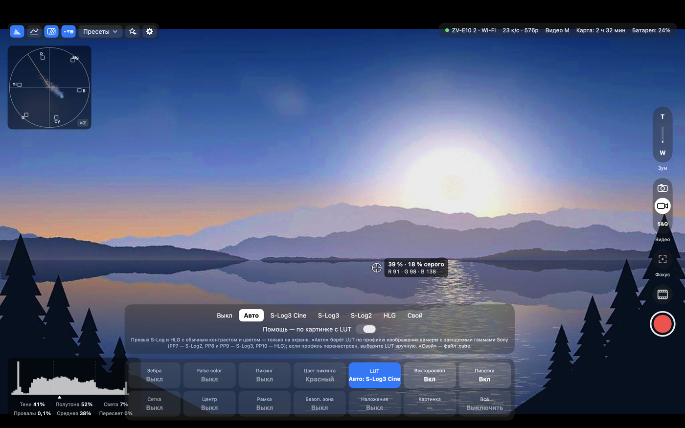
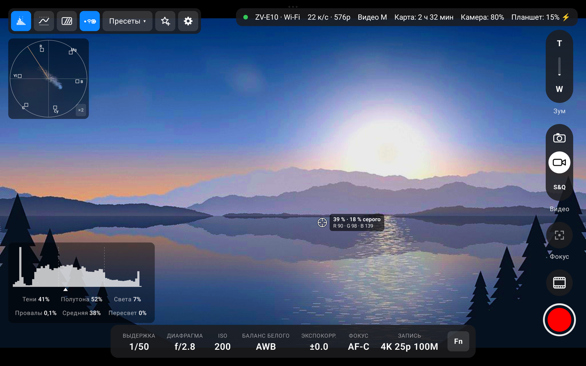
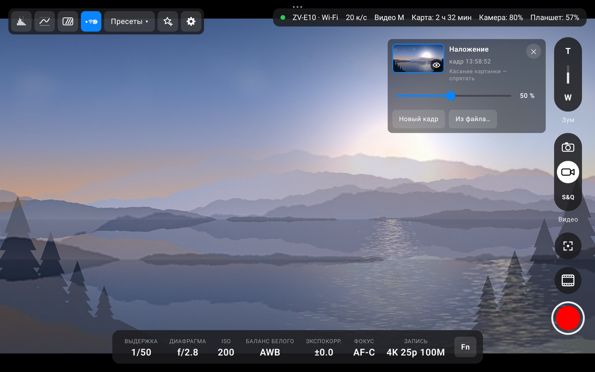

<p align="center"><b>Русский</b> · <a href="README.en.md">English</a></p>

<h1 align="center">Sony Cam Viewer</h1>

<p align="center">
  <b>Живое видео с камеры Sony и пульт к ней — на Android-планшете и на Mac.</b><br>
  По кабелю USB-C или по Wi-Fi. Открыл — сразу картинка, основные настройки в одно касание.
</p>

<p align="center">
  <a href="https://github.com/Scryptor/SonyCamViewer/releases/latest"></a>
  
  
</p>

<p align="center">
  <a href="https://github.com/Scryptor/SonyCamViewer/releases/latest/download/Sony-Cam-Viewer.apk"><b>⬇ Скачать для Android (APK)</b></a>
  &nbsp;·&nbsp;
  <a href="https://github.com/Scryptor/SonyCamViewer/releases/latest/download/Sony-Cam-Viewer.dmg"><b>⬇ Скачать для Mac (DMG)</b></a>
</p>


Замена Imaging Edge Desktop (Remote) без лишнего — для камер Sony с режимом PC Remote, см. [Какие камеры подойдут](#какие-камеры-подойдут). Бесплатно, без рекламы и регистрации.

> [!IMPORTANT]
> **Программа молодая.** Долго в боевых условиях — на настоящих съёмках — её ещё не гоняли, поэтому возможны детские болячки. Очень ждём ваших отзывов: что работает, что нет, чего не хватает. Пишите в [Issues](https://github.com/Scryptor/SonyCamViewer/issues) — всё исправим. Как рассказать об ошибке — в разделе [Обратная связь](#обратная-связь).

> [!NOTE]
> **Пока есть интерфейсы для Android-планшета и для Mac.** На телефоне программа запустится, но раскладка рассчитана на большой экран; версия под телефоны будет в ближайшее время.

## Главное

- 📺 **Живое видео на весь экран** до 25 кадров в секунду — по USB-C, по Wi-Fi через роутер или напрямую (Wi-Fi Direct). Слабый сигнал программа переживает без разрыва.
- 🎛 **Настройки как на дисплее камеры**: выдержка, диафрагма, ISO, баланс белого, экспокоррекция, фокус, режим записи. Касание — меню Fn поверх кадра, плюс «Все настройки» по группам.
- 🔴 **Запись видео и фото** со спуском и автофокусом. REC с таймером и красная рамка вокруг кадра, снимки — на планшет, Mac или карту. На Android спуск и запись можно повесить на кнопки громкости.
- 🎥 **До 4 камер сразу**: главная на большом экране, остальные — живыми плитками. Переключение мгновенное, даже во время записи.
- 🔗 **Группа или каждая камера сама по себе**: связанные с главной камеры повторяют за ней настройки, пресеты и запись — одна кнопка на все; несвязанные настраиваются отдельно.
- ⭐ **Пресеты** отдельно для фото и видео — свои настройки одной кнопкой.
- 📊 **Гистограмма, волновая форма и вектороскоп**, цифровое увеличение до 8× для фокуса, галерея снимков с проверкой резкости.
- 🖥 **Как у мониторов**: зебра, false color, пикинг (работает и на увеличении до 8×), волновая форма и RGB-парад, вектороскоп, пипетка (яркость и цвет в точке кадра), сетка, центр, рамки 9:16 / 4:5 / 1:1 / 2.39, безопасная зона.
- 🎨 **LUT для превью S-Log и HLG**: плоская картинка лога — с привычным контрастом и цветом; «Авто» берёт LUT по профилю камеры, можно добавить свой `.cube`. **Зеркало и переворот** картинки — снимать себя или камеру на риге. Всё только на экране: на запись не влияет.
- 👻 **Наложение эталонного кадра** — повторить сцену: прошлый кадр, снимок или любая картинка из файла поверх живого видео. Прозрачность — ползунком, щелчок по миниатюре прячет и возвращает эталон: «было / стало» в одно касание.
- 🎯 **Фокус и зум с экрана**: фокус касанием по кадру с рамками фокуса камеры, моторный зум (T / W), шкала ручного фокуса с метками A и B — запомнить фокус и плавно перевести к нему за 0–8 секунд.
- 🧩 Без драйверов, root и сторонних библиотек. Код открыт.

## Как начать

1. **Скачайте** программу: [APK для Android](https://github.com/Scryptor/SonyCamViewer/releases/latest/download/Sony-Cam-Viewer.apk) или [DMG для Mac](https://github.com/Scryptor/SonyCamViewer/releases/latest/download/Sony-Cam-Viewer.dmg) — подробнее в [Установке на Mac](#установка-на-mac) и [на Android](#установка-на-android).
2. **На камере** один раз включите PC Remote: MENU → Network → PC Remote Function → PC Remote: **On** — см. [Настройку камеры](#настройка-камеры).
3. **Подключите** камеру кабелем USB-C — через несколько секунд появится картинка. Или [по Wi-Fi](#подключение-по-wi-fi) — без кабеля.

<p align="center">
  <a href="#скачать">Скачать</a> ·
  <a href="#какие-камеры-подойдут">Камеры</a> ·
  <a href="#установка-на-android">Android</a> ·
  <a href="#установка-на-mac">Mac</a> ·
  <a href="#настройка-камеры">Настройка камеры</a> ·
  <a href="#подключение-по-wi-fi">Wi-Fi</a> ·
  <a href="#управление">Управление</a> ·
  <a href="#ограничения">Ограничения</a> ·
  <a href="#обратная-связь">Обратная связь</a> ·
  <a href="#сборка-из-исходников">Сборка</a>
</p>

## Скачать

| | Mac | Android |
|---|---|---|
| **Файл** | [Sony-Cam-Viewer.dmg](https://github.com/Scryptor/SonyCamViewer/releases/latest/download/Sony-Cam-Viewer.dmg) | [Sony-Cam-Viewer.apk](https://github.com/Scryptor/SonyCamViewer/releases/latest/download/Sony-Cam-Viewer.apk) |
| **Что нужно** | Mac на Apple Silicon, macOS 14 или новее | Android 10 или новее, планшет с USB OTG (раскладка под телефоны — скоро) |
| **Камера подключается** | кабелем USB-C или по Wi-Fi | кабелем USB-C или по Wi-Fi |
| **Как поставить** | [Установка на Mac](#установка-на-mac) | [Установка на Android](#установка-на-android) |

Все версии — на странице [Releases](https://github.com/Scryptor/SonyCamViewer/releases).

**Документация:** [руководство пользователя](docs/user-guide.md) · [протокол камеры](docs/protocol.md) · [устройство кода](docs/architecture.md) · [API автоматизации](docs/automation-api.md)

## Как это выглядит

| Mac | Android-планшет |
|---|---|
|  |  |

| «Монитор» на Mac: пикинг, зебра, трети, волновая форма | «Монитор» на планшете: рамка 9:16, безопасная зона, зебра, пикинг |
|---|---|
|  |  |

| LUT на Mac: S-Log3 с «Авто», вектороскоп, пипетка | LUT на планшете: S-Log3 с «Авто», вектороскоп, пипетка |
|---|---|
|  |  |

Камера снимает в S-Log3 (профиль PP8), а на экране — картинка с привычным контрастом и цветом: «Авто» само выбрало LUT по профилю. Без LUT та же сцена выглядела бы плоской и серой. LUT, вектороскоп и пипетка меняют только экран — запись остаётся в логе. Подробно — в [руководстве](docs/user-guide.md#lut-превью-s-log-и-hlg).

| Фокус и зум на Mac: шкала фокуса, метки A и B, RGB-парад | Метки фокуса на планшете: шкала в MF, A и B, время перевода |
|---|---|
|  |  |

| Наложение кадра на Mac | Наложение кадра на планшете |
|---|---|
|  |  |

Наложение кадра — чтобы повторить сцену: эталон (прошлый кадр, снимок или любая картинка из файла) лежит полупрозрачно поверх живого видео, где картинки расходятся — всё двоится. На панели наложения — прозрачность ползунком, а щелчок по миниатюре прячет и возвращает эталон. Подробно — в [руководстве](docs/user-guide.md#наложение-кадра-повторить-сцену).

| Меню Fn на Mac | Меню Fn на планшете |
|---|---|
|  |  |

| Лента камер и группа на Mac | Четыре камеры и запись на планшете |
|---|---|
|  |  |

<details>
<summary><b>Ещё скриншоты</b>: экран ожидания, все настройки, фоторежим, просмотр снимка, окно пресетов</summary>

| Экран ожидания на Mac | Экран ожидания на планшете |
|---|---|
|  |  |

| Все настройки | Фоторежим |
|---|---|
|  |  |

| Просмотр после съёмки | Окно «Пресеты» на планшете |
|---|---|
|  |  |

</details>

На скриншотах — виртуальная камера из `scripts/fake_camera.py`. В её видоискателе нарисованное кодом горное озеро, а не съёмка настоящей камеры.

## Что умеет


На Mac и на Android одно и то же:

<details>
<summary><b>Все возможности подробно</b> — нажмите, чтобы раскрыть</summary>

- **Сама находит камеру** — по кабелю USB или по Wi-Fi в домашней сети — и показывает живое видео на весь экран, до 25 кадров в секунду. Отключили кабель — подключается по Wi-Fi или ждёт камеру. См. [Подключение по Wi-Fi](#подключение-по-wi-fi).
- **Несколько камер.**
  - Программа помнит каждую камеру, к которой подключалась, и видит те, что на кабеле или в сети.
  - Список камер открывается щелчком по имени камеры в строке состояния; он есть и на экране ожидания. В нём можно подключить другую камеру, сопрячь новую, дать камере своё имя или забыть её.
  - Несколько камер по Wi-Fi держатся на связи сразу. Главная — на большом экране, остальные — живыми плитками в ленте слева.
  - Щелчок по плитке делает камеру главной мгновенно, без переподключения, в том числе во время записи. Плитки при этом не прыгают, а переставляют их перетаскиванием.
  - Пока цепочки на плитках не горят, каждая камера сама по себе: у каждой свои настройки, щелчок по плитке — и настраиваете её.
  - Цепочка на плитке связывает камеру с главной — получается группа. Камеры группы повторяют за главной настройки, пресеты и запись — одной кнопкой на все камеры.
  - Главная не из группы — группа ждёт: её камеры ни за кем не повторяют, пока главной снова не станет камера группы.
  - Связь не перезаписывает то, что уже стоит на камере. Настроить одну камеру группы отдельно: отвязать, настроить, связать снова. Подробнее — в [Руководстве](docs/user-guide.md#группа-связанные-камеры).
  - После перезапуска — та же главная, та же лента, тот же порядок и те же связи.
- **Экран ожидания** — пока камеры нет.
  - В рамке фокуса написано, что программа делает и что сделать вам. Сразу под ней — список камер с «Подключить» и «Сопрячь».
  - Шаги подключения по кабелю и по Wi-Fi раскрыты при первом запуске, а потом свёрнуты.
  - Если Wi-Fi выключен в настройках, «Включить Wi-Fi» прямо на этом экране.
- **Отладка** — ⌥⌘D на Mac или долгое нажатие на строку состояния на планшете: панель по вкладкам со всем, что программа знает о связи (сигнал, отклик камеры, поток, провалы и восстановления), превью, камере и всех её свойствах, плюс журнал событий; «Скопировать» отдаёт всё текстом. У камер нового поколения во вкладке «Камера» — ещё версия кода камеры, присланные ею списки подписей и таблицы объектива.
- **Строка состояния**: камера и способ связи, счётчик кадров, заряд. Видна вместе с остальными элементами, а кнопка с точкой и Wi-Fi вверху слева закрепляет её — тогда она остаётся на экране и когда элементы спрятаны. Нажатие на имя камеры (например, «ZV-E10 · Wi-Fi») показывает список камер, прошивку, адреса камеры и устройства и уровень сигнала; у счётчика кадров всегда видно разрешение превью («23 к/с · 576p»), а нажатие на него открывает выбор качества превью — «Авто», «1024×576» или «640×360» — и сводку: что это кадры трансляции, а не записи, и самая долгая пауза между кадрами.
- **Строка значений внизу**, как на дисплее камеры: выдержка, диафрагма, ISO, баланс белого, экспокоррекция, фокус, в видеорежиме — режим записи («4K 25p 100M»), в фоторежиме — формат снимка. Нажатие на значение открывает меню Fn поверх кадра.
- **Фото, видео и S&Q** (замедленная и ускоренная съёмка) — переключатель справа, три значка в капсуле, делает то же, что кнопка MODE на камере. В S&Q в строке состояния видно частоту съёмки и замедление, например «100 к/с · ×4 замедл.». Саму частоту съёмки (1–100 к/с) камера по кабелю менять не даёт: она в меню камеры.
- **Режим записи одним выбором**: формат, частота и битрейт вместе — 4K 25p 100M, HD 100p 100M, HD 50p 50M и так далее. 100p есть только в HD, программа сама переключит формат видео.
- **Меню Fn**: сетка 2×6, как на камере, — 11 настроек и вход во все остальные. Для баланса белого есть цветовая температура и площадка сдвига A–B / G–M. Ползунок температуры работает в любом режиме: сдвинули — камера переходит на ручную температуру.
- **«Все настройки»** по группам: экспозиция, фокус, цвет и картинка, видео, фото, камера.
- **Запись видео** кнопкой. Пока идёт запись, видна метка REC с таймером и красная рамка вокруг картинки, как у мониторов; рамку можно выключить, сделать толще или тоньше, бледнее и мигающей.
- **Отклик на кнопки съёмки.** Палец закрывает кнопку, поэтому отклик — вокруг неё и на кадре: кольцо и волна, затемнение в момент спуска, стоп-кадр улетает в ленту. Пока камера занята, на кнопке дуга, слева подпись: «Фокусировка…», «Загрузка 42 %», «Запуск записи…». Если запись не пошла, там же на несколько секунд — почему: «Камера занята — запись не началась», «Камера начала запись и сразу остановила». На Android — ещё и вибрация, если у устройства есть мотор.
- **Кнопки громкости** (только на Android): спуск в фоторежиме, начало и остановка записи в видео и S&Q — как нажатие кнопки на экране и с тем же откликом. Включаются в ⚙, по умолчанию выключены; работают на экране с кадром, а пока включены — громкость не меняют. Так же действует кнопка «Камера» на Bluetooth-пультах для телефонов.
- **Фоторежим.** Переключатель «Фото / Видео / S&Q» справа. Спуск с автофокусом. Снимки сохраняются на Mac или планшет, на карту или туда и туда. При RAW+JPEG скачиваются оба файла.
- **Просмотр после съёмки**: снимок показывается 1–10 секунд, можно выключить. На выбор — скачанный файл или кадр с камеры.
- **Стоп-кадр из видео**, запись при этом не прерывается.
- **Лента последних снимков и галерея**: листание (смахивание, стрелки), лента всех снимков сеанса, увеличение снимка с догрузкой полного разрешения — проверить резкость. Неудачный снимок — «Удалить»: файлы уходят в корзину Mac или планшета, а ещё 6 секунд его можно вернуть кнопкой «Вернуть». Копия на карте камеры остаётся.
- **Цифровое увеличение live view** двумя пальцами (на Mac — щипок на трекпаде и ⌘= / ⌘− / ⌘0), до 8×, с мини-картой, множителем и кнопкой отмены. Камера о нём не знает. Видимая часть пересчитывается бикубически, а превью по Wi-Fi держится в полном размере до последнего.
- **Гистограмма** — отдельной кнопкой; её можно перетащить куда угодно, и она не прячется вместе с остальными элементами. Шкала поделена на трети, под графиком доли теней, полутонов и светов, провалы в чёрное, средняя яркость и пересвет. Пересвет и провалы от 1 % подсвечиваются жёлтым.
- **Волновая форма** — своей кнопкой рядом с гистограммой, перетаскивается так же: яркость по столбцам кадра или RGB-парад, линии 0, 50 и 100 % белого превью.
- **Монитор** — кнопка вверху слева (на Mac ещё M) открывает внизу плитки, как меню Fn:
  - зебра 100 %, 95 % или 70 % для кожи;
  - false color с легендой: провалы, тени, 18 % серого, кожа, почти белое, пересвет;
  - пикинг — подсветка резких краёв, четыре цвета и три уровня; при цифровом увеличении считается по увеличенной картинке, и на 8× край — тонкая линия;
  - LUT — превью S-Log и HLG с привычным контрастом и цветом: «Авто» берёт LUT по профилю изображения камеры (S-Log2, S-Log3 с двумя охватами, HLG), можно выбрать вручную или добавить свой файл `.cube` (до 12; на Mac его можно просто перетащить на окно). Гистограмма, волновая форма и остальная помощь по умолчанию считаются по картинке с LUT, переключатель «Помощь — по картинке с LUT» возвращает их к сигналу камеры;
  - вектороскоп — цвета кадра на круге: оттенок — направлением, насыщенность — расстоянием от центра; метки цветных полос 75 % и линия тона кожи; касание панели — масштаб ×2, чтобы разглядеть бледные цвета лога;
  - пипетка — яркость в процентах, R, G, B и зона false color под меткой (среднее по квадрату 5×5 точек); пока она включена, касание кадра ставит её, а не фокус, а метку можно тащить;
  - сетка (трети или квадраты), центр, рамки 9:16, 4:5, 1:1, 4:3 и 2.39:1 с затемнением снаружи, безопасная зона 90 или 80 %;
  - наложение кадра — эталон полупрозрачно поверх живого, чтобы повторить сцену: доснять на другой день, повторить ракурс второй камерой, сделать «до и после». Эталон — текущий кадр, снимок из галереи или любая картинка из файла (на Mac её можно просто перетащить на окно). На панели наложения — миниатюра эталона (щелчок прячет и возвращает его, на Mac ещё клавиша O), ползунок непрозрачности 5–100 %, смена эталона. Эталон помнится между запусками и увеличивается вместе с кадром;
  - картинка — зеркало, переворот вверх ногами или то и другое вместе: снимать себя, камера на риге или подвесе. Фокус касанием, рамки фокуса камеры и эталон наложения переезжают вместе с картинкой, поэтому касание попадает туда, куда указывает палец.

  Всё считается по превью и только на экране: на запись не влияет, а снимки, стоп-кадры, эталон наложения и сама камера остаются как есть.
- **Фокус касанием**: включили кнопку справа — касание кадра ставит туда фокус (в зонах «Точка» и «Зона» — точка AF, в остальных — как касание экрана камеры: фокус или слежение; пока включена пипетка, касание ставит её, а не фокус), поверх кадра — рамки фокуса самой камеры, они видны всегда: выключили кнопку — начатое слежение продолжается, его рамка видна, а касания его не сбивают; снять — «Снять слежение». При включении — подсказка, как это работает и что сделает касание сейчас, с галочкой «Больше не показывать»; снова — правым щелчком (Mac) или долгим нажатием (планшет) на кнопку.
- **Моторный зум**: «T» и «W» справа — держите, и камера зумирует; объектив с электроприводом (китовый PZ 16-50) или Clear Image Zoom камеры. Показаны положение зума и масштаб.
- **Шкала фокуса** в ручном фокусе: ближе и дальше шагами 1, 3, 7 или перетаскиванием, как кольцом, с меткой положения фокуса. Если камера сообщает данные объектива, под шкалой подписаны расстояния («0,5 м», «1 м», «∞»), а у метки положения — текущее.
- **Метки фокуса A и B** под шкалой. «A+» запоминает, где сейчас фокус; «A» плавно переводит фокус туда за 0, 1, 2, 4 или 8 секунд — например, с одного предмета на другой без рывка. Время переключает кнопка «⏱ 2 с», правый щелчок (Mac) или долгое нажатие (планшет) на метке — «Запомнить здесь» и «Стереть». Перевод останавливают касание едущей метки и любое ручное движение фокуса. При первом появлении меток — карточка «Метки фокуса» с галочкой «Больше не показывать». Метки у каждой камеры свои и живут, пока программа запущена.
- **Пресеты** — свои у фото и у видео: сохранить настройки под своим именем и вернуть их одной кнопкой. В списке видно, что ставит каждый пресет и какой стоит сейчас. Поменяли что-то на камере после пресета — на кнопке оранжевая точка, а «Сохранить в «…»» записывает изменения в него; «Новый пресет…» делает новый. В окне пресетов можно поправить любое значение, порядок и то, что пресет меняет, а «Посмотреть» показывает пресет на камере, пока кнопку держат, — отпустили, и всё как было.
- **Элементы управления прячутся** сами (через 1–30 секунд, задаётся в настройках) или по команде.
- Без драйверов и сторонних библиотек: на Mac — системные ImageCaptureCore и Network, на Android — системный USB host и обычные сокеты.

</details>

## Какие камеры подойдут

Программа сделана на ZV-E10, но к этой модели не привязана: она подключается к любой камере Sony, у которой есть режим PC Remote по USB или по Wi-Fi. Насколько она заработает, зависит от поколения камеры.

| | Камеры | Что будет работать |
|:---:|---|---|
| ✅ | **ZV-E10** (прошивка 2.00) | всё |
| 🟢 | **Sony примерно с 2020 года**: a7S III, a7C, a7 IV, a7R V, a1, a9 III, FX3, a6700 и другие | скорее всего, всё: у них та же версия протокола, что у ZV-E10. Возможные отличия: редкие значения подписаны по-английски, как в справочнике Sony, или как `#N`; на камерах с колесом режимов может не работать переключатель «Фото / Видео / S&Q»; пункты меню для включения PC Remote лежат в других разделах |
| 🟡 | **Sony до 2020 года**: a6000, a6400, a6600, a7 III, a7R III, RX100 VI и другие | может подключиться и показать видео, но выдержку, ISO и экспокоррекцию такие камеры меняют шагами «+1 / −1», а программа пишет значения напрямую, поэтому их изменение, скорее всего, не заработает |

**Подписи и шкала фокуса у других камер Sony.** Названия значений программа берёт у самой камеры, если та умеет их присылать (так подписан Creative Look), а для остальных — из справочника Sony «Camera Control PTP 3 Reference» (там названия английские), поэтому `#N` встречается реже. Если у камеры есть Creative Look, а творческого стиля нет, в меню Fn и во «Всех настройках» на его месте стоит Creative Look. Камеры, которые сообщают данные объектива, получают расстояния под шкалой фокуса, а метки A и B на камерах с абсолютным фокусом переводят фокус записью положения. «Авто» у LUT на камерах, которые сообщают гамму и цветовой режим профиля, берёт их из камеры. Подробности — в [протоколе камеры](docs/protocol.md#другие-камеры-sony).

Всё это сделано по справочнику Sony и отлажено на виртуальной камере; настоящей камеры, которая присылает такие подписи и данные объектива, у нас не было. Если подпись, шкала или расстояние выглядят не так, как в меню камеры, пришлите отчёт из «Отладки» (<kbd>⌥</kbd><kbd>⌘</kbd><kbd>D</kbd> на Mac или долгое нажатие на строку состояния на планшете → вкладка «Камера» → «Скопировать»): в нём версия кода камеры, списки подписей и таблицы объектива. Отчёт содержит все списки названий, которые камера присылает, а в списках кнопок или FTP-серверов бывают названия, которые вы ввели сами, — просмотрите его перед отправкой.

> [!TIP]
> Попробовать на другой камере Sony безопасно: при подключении программа только передаёт управление компьютеру и не трогает настройки, пока вы сами их не поменяете. Если попробовали — расскажите в [Issues](https://github.com/Scryptor/SonyCamViewer/issues), что работает, а что нет.

## Установка на Android

Нужен Android 10 или новее и планшет, к которому по USB можно подключать устройства (USB host, OTG): это умеет почти любой современный. Программа сделана на Redmi Pad Pro с Android 14. На телефоне она тоже запустится, но раскладка пока рассчитана на экран планшета; версия под телефоны — в ближайшее время.

1. Скачайте [Sony-Cam-Viewer.apk](https://github.com/Scryptor/SonyCamViewer/releases/latest/download/Sony-Cam-Viewer.apk) прямо на планшет и откройте его. Android попросит разрешить установку из этого источника — разрешите.
2. [Настройте камеру](#настройка-камеры) и подключите её к планшету кабелем USB-C.
3. Android спросит, дать ли программе доступ к камере, — нажмите «ОК». Если в окне есть галочка «всегда открывать при подключении» — отметьте её: тогда программа будет запускаться сама, как только вы подключите камеру.

Снимки и стоп-кадры сохраняются в «Загрузки/ZV-E10» и видны в галерее.

> [!TIP]
> Разъём у планшета один, поэтому, пока подключена камера, он работает от батареи. Заряжать его одновременно можно через USB-C-хаб с проходной зарядкой — или подключить камеру [по Wi-Fi](#подключение-по-wi-fi). Заряд и камеры, и планшета виден в строке состояния.

## Установка на Mac

Нужен Mac на Apple Silicon и macOS 14 или новее.

1. Скачайте [Sony-Cam-Viewer.dmg](https://github.com/Scryptor/SonyCamViewer/releases/latest/download/Sony-Cam-Viewer.dmg).
2. Откройте его и перетащите «Sony Cam Viewer» в «Программы».
3. Откройте программу в первый раз — см. ниже.
4. [Настройте камеру](#настройка-камеры) и подключите её к Mac кабелем USB-C.

> [!IMPORTANT]
> Программа не подписана сертификатом разработчика Apple, поэтому при первом запуске macOS её не откроет. Чтобы открыть:
> 1. попробуйте запустить программу и закройте предупреждение;
> 2. откройте «Системные настройки» → «Конфиденциальность и безопасность», внизу нажмите «Всё равно открыть».
>
> Или одной командой в Терминале:
>
> ```bash
> xattr -dr com.apple.quarantine "/Applications/Sony Cam Viewer.app"
> ```

> [!NOTE]
> - При первом снимке в папку «Загрузки» macOS может спросить разрешение на доступ к ней: разрешите.
> - Если в «Программах» есть ZV-E10 Viewer (так программа называлась раньше), после установки удалите её: настройки и пресеты общие и сохранятся.

## Настройка камеры

Один раз на камере:

| | Пункт меню | Значение |
|:---:|---|---|
| 1 | MENU → Network → Smartphone Connect → Smartphone Connection | **Off** |
| 2 | MENU → Network → PC Remote Function → PC Remote | **On** |
| 3 | MENU → Network → PC Remote Function → PC Remote Cnct Method | **USB** |

Потом подключите камеру кабелем USB-C к Mac или к планшету. Через несколько секунд появится картинка.

Пункты меню — для ZV-E10. На других камерах Sony они называются похоже, но могут лежать в других разделах меню.

> [!NOTE]
> На Mac после установки и после каждого обновления macOS спросит, можно ли программе читать «файлы на съемном томе», — нажмите «Разрешить». Без этого macOS не отдаёт программе камеру; программа подскажет это на экране ожидания.

> [!TIP]
> Камера подключена, но картинки нет? Закройте Imaging Edge и другие программы, которые могли занять камеру, и переподключите кабель.

## Подключение по Wi-Fi

Без кабеля программа находит камеру сама — в домашней сети или в сети, которую раздаёт камера.

### Через домашний роутер

Один раз:

1. На камере: MENU → Network → Wi-Fi Settings → Access Point Set. — подключите камеру к домашнему роутеру. ZV-E10 работает только в диапазоне 2,4 ГГц, Mac или планшет могут быть в той же сети в любом диапазоне.
2. MENU → Network → PC Remote Function → PC Remote: **On**, PC Remote Cnct Method: **Wi-Fi Access Point**.
3. Запустите программу без кабеля и на экране ожидания нажмите «Сопрячь новую камеру…» под списком камер.
4. На камере: MENU → Network → PC Remote Function → **Pairing** и подтвердите.

Дальше программа подключается сама, как только камера появится в сети.

- Mac и планшет сопрягаются по отдельности, камера помнит оба, но подключено может быть только одно устройство сразу.
- Если камера на кабеле в режиме PC Remote по USB, связь идёт по USB, а уже идущую связь по Wi-Fi кабель (например, зарядка) не рвёт.
- Камер в сети несколько — каждая сопрягается один раз, а какую подключать, выбирают в списке камер.
- «Забыть сопряжение» в настройках — у программы новое имя для камер: все камеры придётся сопрячь заново.
- На Mac при первом подключении разрешите программе доступ к локальной сети.

### Без роутера (Wi-Fi Direct)

Например, на улице: камера сама раздаёт сеть.

1. На камере: PC Remote Cnct Method: **Wi-Fi Direct**. Камера покажет имя своей сети (`DIRECT-…`) и пароль.
2. Подключите планшет или Mac к этой сети. Android предупредит, что в ней нет интернета, — останьтесь подключёнными.
3. Программа найдёт камеру сама, в строке состояния будет «Wi-Fi Direct».

Превью на планшете — 23–25 кадров в секунду, RAW+JPEG — около 20 секунд. Устройство, уже сопряжённое через роутер, подключается без нового сопряжения. Mac, подключённый к сети камеры, на это время остаётся без интернета.

### Скорость и слабый сигнал

| | По кабелю | По Wi-Fi |
|---|---|---|
| Превью | до 25 к/с | до 25 к/с |
| RAW+JPEG, от нажатия до файла | около 4 с | около 14 с на планшете, 12–14 с на Mac |
| Батарея камеры | — | садится быстрее |

Замирание связи программа пережидает, не разрывая подключение: последний кадр остаётся на экране, сверху — «Слабый сигнал Wi-Fi», а если связи нет дольше пары секунд — «Связь с камерой прервалась» и сколько это длится. Связь вернулась — картинка идёт дальше сама. Если подключение всё же оборвалось, программа сразу подключается заново (обычно за 1–2 секунды), кадр и настройки остаются на экране.

Полное качество превью — около 14 Мбит/с, это почти потолок Wi-Fi камеры. Поэтому в режиме «Авто» (так по умолчанию) при слабом сигнале программа сама переходит на 640×360: картинка мельче, но идёт плавно, а при хорошем сигнале возвращается полное качество. Разрешение всегда видно у счётчика кадров в строке состояния («576p», «360p»). Нажатие на счётчик открывает выбор: «Авто», «1024×576» — всегда полное, «640×360» — всегда облегчённое; то же — в настройках. По кабелю превью всегда полное.

## Управление

### На Android

| Жест | Что делает |
|---|---|
| Касание видео | спрятать или вернуть элементы управления; без касаний они прячутся сами, через сколько секунд — задаётся в настройках |
| Касание значения внизу | меню Fn; значения меняются касанием, ленту значений можно листать пальцем |
| Два пальца на видео | цифровое увеличение до 8×; ✕ в правом нижнем углу возвращает весь кадр |
| Касание плитки камеры | сделать камеру главной |
| Долгое нажатие на плитку | меню камеры; если после него повести пальцем — плитка поменяет место |
| Касание снимка в ленте | галерея: листать смахиванием, увеличивать щипком или двойным касанием, закрыть смахиванием вниз или «Назад»; «Удалить» вверху — снимок в корзину планшета |
| Долгое нажатие на снимок | открыть файл в другой программе |
| Долгое нажатие на «Пресеты» | панель «Пресеты», где их правят |
| Перетаскивание гистограммы, волновой формы, вектороскопа или панели наложения | поставить её куда угодно |
| Касание вектороскопа | масштаб ×1 или ×2 |
| Касание миниатюры эталона на панели наложения | спрятать или показать эталон |
| Касание кадра, когда горит «фокус касанием» | фокус в эту точку; пока включена пипетка — пипетка в эту точку (метку можно тащить) |
| Удержание «T» или «W» | моторный зум |
| Перетаскивание шкалы фокуса (в MF) | ближе или дальше, как кольцом фокуса |
| Касание метки «A+» или «B+» под шкалой фокуса | запомнить, где сейчас фокус |
| Касание заданной метки «A» или «B» | перевести фокус к ней за выбранное время; касание едущей метки — остановить |
| Долгое нажатие на метку | «Запомнить здесь» или «Стереть» |
| Долгое нажатие на кнопку времени «⏱ 2 с» | карточка «Метки фокуса» |
| Кнопки громкости и «Камера» (если включены в ⚙) | спуск в фоторежиме, начало и остановка записи в видео и S&Q |
| Долгое нажатие на строку состояния | панель отладки |

- **Пресеты** — кнопка вверху слева, у фото и у видео свои: касание открывает список, ☆+ сохраняет настройки — в текущий пресет или новым.
- **Монитор** — кнопка с полосками вверху слева: 14 плиток внизу экрана — зебра, false color, пикинг и его цвет, LUT, вектороскоп, пипетка, сетка, центр, рамка, безопасная зона, наложение кадра, «Картинка» (зеркало и переворот) и «Всё — выключить»; касание плитки выбирает её, повторное — включает или выключает. «Добавить LUT…» открывает системный выбор файла.
- **Строка состояния** видна вместе с остальными элементами, а кнопка с точкой и Wi-Fi вверху слева закрепляет её: пока кнопка горит синим (так по умолчанию), строка остаётся на экране и когда элементы спрятаны.
- **Вибрация**: если у устройства есть вибромотор, кнопки съёмки отвечают вибрацией (выключается в настройках). У Redmi Pad Pro мотора нет — там отклик только на экране.
- **Настройки** — кнопка ⚙ вверху слева: куда сохранять снимки (на планшет и на карту, только на планшет, только на карту), сколько секунд и что показывать после съёмки, красная рамка во время записи, подключаться ли по Wi-Fi и качество превью по Wi-Fi, прятать ли элементы управления и через сколько секунд, «Кнопки громкости — спуск и запись» (по умолчанию выключено).

### На Mac

| Клавиша | Что делает |
|---|---|
| <kbd>F</kbd> | открыть или закрыть меню Fn |
| <kbd>M</kbd> | открыть или закрыть меню «Монитор» |
| <kbd>Z</kbd> <kbd>P</kbd> <kbd>C</kbd> | зебра, пикинг, false color — включить или выключить |
| <kbd>L</kbd> <kbd>V</kbd> <kbd>I</kbd> | LUT, вектороскоп, пипетка — включить или выключить |
| <kbd>O</kbd> | наложение кадра: включить, спрятать или показать эталон |
| <kbd>T</kbd> <kbd>W</kbd> (держать) | моторный зум к теле или к широкому |
| <kbd>←</kbd> <kbd>→</kbd> | изменить выбранную настройку в меню Fn или «Монитор»; в галерее — соседний снимок |
| <kbd>1</kbd>–<kbd>9</kbd> | применить пресет |
| <kbd>⇧</kbd><kbd>⌘</kbd><kbd>P</kbd> | окно пресетов |
| <kbd>Пробел</kbd> | снимок в фоторежиме; закрыть просмотр снимка или галерею |
| <kbd>S</kbd> | стоп-кадр в видеорежиме |
| <kbd>H</kbd> | скрыть или показать элементы управления |
| <kbd>Esc</kbd> | закрыть меню, просмотр или галерею |
| <kbd>⌘</kbd><kbd>⌫</kbd> | в галерее — снимок в Корзину; <kbd>⌘</kbd><kbd>Z</kbd> — вернуть, пока видна «Вернуть» |
| <kbd>⌘</kbd><kbd>=</kbd> <kbd>⌘</kbd><kbd>−</kbd> <kbd>⌘</kbd><kbd>0</kbd> | увеличить или уменьшить картинку, вернуть весь кадр |
| <kbd>⌥</kbd><kbd>⌘</kbd><kbd>D</kbd> | панель отладки |
| <kbd>⌘</kbd><kbd>,</kbd> | настройки программы |

Буквы работают и в русской раскладке (F/А, S/Ы, H/Р, M/Ь, Z/Я, P/З, C/С, L/Д, V/М, I/Ш, O/Щ, T/Е, W/Ц).

- **Мышь и трекпад.** Колесо мыши над меню Fn листает значения выбранной настройки, над шкалой фокуса — фокусирует по шагу. Щипок на трекпаде увеличивает картинку. Гистограмму, волновую форму, вектороскоп и панель наложения можно утащить мышью куда угодно, щелчок по вектороскопу переключает масштаб ×1 / ×2. Картинку из Finder можно перетащить на окно — она станет эталоном наложения, а файл `.cube` — своим LUT. Когда горит «фокус касанием» (кнопка справа), щелчок по кадру ставит туда фокус; когда включена пипетка — ставит пипетку (метку можно тащить).
- **Метки фокуса.** Щелчок по «A+» или «B+» под шкалой фокуса запоминает фокус, по заданной метке — переводит к ней фокус, по едущей — останавливает; правый щелчок по метке — «Запомнить здесь» и «Стереть», по кнопке времени — «Как работают метки фокуса…» (карточка «Метки фокуса»).
- **Лента камер.** Щелчок по плитке делает камеру главной, перетаскивание меняет место.
- **Пресеты** — кнопка вверху слева, у фото и у видео свои: клик открывает список, где видно, что ставит каждый пресет, ☆+ сохраняет настройки — в текущий пресет, если его поменяли на камере, или новым, а «Вид → Пресеты…» (<kbd>⇧</kbd><kbd>⌘</kbd><kbd>P</kbd>) открывает окно, где пресеты переименовывают, переставляют и правят по одной настройке.
- **Снимки.** Клик по снимку в ленте открывает галерею, правый клик — «Показать в Finder», «Открыть» или «В Корзину».
- **Строка состояния** закрепляется кнопкой с точкой и Wi-Fi вверху слева — тогда она не прячется с остальными элементами.
- **Настройки программы** — кнопка ⚙ вверху слева или <kbd>⌘</kbd><kbd>,</kbd>: куда сохранять снимки (на Mac и на карту, только на Mac, только на карту) и в какую папку, сколько секунд и что показывать после съёмки, красная рамка во время записи (включить, толщина, яркость, мигание), подключаться ли по Wi-Fi и качество превью по Wi-Fi, прятать ли элементы управления и через сколько секунд.

Подробно обо всех функциях — в [руководстве пользователя](docs/user-guide.md).

## Ограничения

Часть ограничений — от самой камеры, программа их не обойдёт:

- **Только превью.** Камера отдаёт и по USB, и по Wi-Fi только превью: 1024×576 в видеорежиме, в фоторежиме зависит от соотношения сторон (при 1:1 — 1024×1024), до 25 кадров в секунду. Больше не бывает: свойство качества превью по USB картинку не меняет, а по Wi-Fi умеет её только уменьшить (640×360) — этим программа и пользуется при слабом сигнале. Видео лучшего качества дают режим камеры USB Streaming (камера становится веб-камерой) или захват по HDMI, но это уже без этой программы.
- **Стоп-кадр** из видео поэтому — кадр превью, 1024×576, а не полноразмерный снимок.
- **Экспонометр** (M.M.) в ручном режиме камера не отдаёт, программа его не показывает.
- **Баланс белого.** Температуру автобаланса и готовых режимов («Дневной», «Тень» и других) камера не сообщает: программа показывает «авто» и примерные значения.
- **S&Q.** Частоту съёмки (1–100 к/с) камера по кабелю не сообщает и менять не даёт: программа узнаёт её по самой длинной разрешённой выдержке, а меняется она в меню камеры (S&Q Settings → Frame Rate).
- **Одно устройство по Wi-Fi.** К камере подключается одно устройство за раз: Mac или планшет.
- **Во время записи** видео нельзя снять фото и переключить режим.
- **Зум.** Программа зумирует объективом с электроприводом зума (у ZV-E10 — китовый PZ 16-50) или Clear Image Zoom камеры, если камера это разрешает; зум с механическим кольцом — только руками. Пока Clear Image Zoom больше ×1,0, камера не даёт ставить фокус касанием. Увеличение двумя пальцами — цифровое, только на экране: снимки и запись — всегда весь кадр, а детали ограничены превью 1024×576.
- **Зебра, false color, пикинг, волновая форма, вектороскоп, пипетка** — по превью, а не по записываемому видео: ориентир, как и гистограмма. Пикинг по превью 1024×576 точнее всего вместе с увеличением, а в тёмной сцене подсвечивает меньше краёв.
- **LUT и «Авто»** — по заводским профилям камеры: PP7 — S-Log2, PP8 и PP9 — S-Log3, PP10 — HLG (на камерах, которые сами сообщают гамму и цветовой режим профиля, — по ним). Если профиль в камере перенастроен, «Авто» ошибётся — выберите LUT вручную. Превью — 8-битный JPEG, поэтому картинка с LUT — ориентир для глаз, а не цветокоррекция. Уровни у превью свои — оно растягивает коды камеры 64…1019 на 0…255 (так у ZV-E10), — и LUT получает код камеры, пересчитанный из превью.
- **Метки фокуса** у камер без абсолютного фокуса (у ZV-E10) ведут объектив шагами «ближе / дальше», поэтому фокус встаёт в метку с точностью до шага объектива. Метки не сохраняются между запусками.
- **Несколько камер сразу** проверены на виртуальных камерах; на нескольких настоящих — пока нет.

## Обратная связь

Программе нужны отзывы с настоящих съёмок — особенно с других камер Sony, других планшетов и долгих записей. Нашли ошибку или чего-то не хватает — откройте [Issues](https://github.com/Scryptor/SonyCamViewer/issues) и напишите:

- камеру и прошивку, Mac или планшет (модель и версию системы);
- как подключена камера: кабелем, через роутер или Wi-Fi Direct;
- что делали, что ожидали и что получилось; скриншот или видео экрана очень помогают;
- журнал из панели отладки: <kbd>⌥</kbd><kbd>⌘</kbd><kbd>D</kbd> на Mac или долгое нажатие на строку состояния на планшете → «Скопировать». Серийный номер, MAC-адрес и GUID в нём не показываются. Но у камеры нового поколения в нём (во вкладке «Камера») есть все списки названий, которые она присылает, а в списках кнопок или FTP-серверов бывают названия, которые вы вводили сами: просмотрите отчёт перед отправкой.

Ошибки чиним быстро, новые версии выходят на странице [Releases](https://github.com/Scryptor/SonyCamViewer/releases).

## Документация

| | |
|---|---|
| 📖 [Руководство пользователя](docs/user-guide.md) | все функции по порядку, настройки программы, решение проблем, отличия Android |
| 🔌 [Протокол камеры](docs/protocol.md) | как программа говорит с камерой по USB и по Wi-Fi: команды, свойства, кодировка значений, подводные камни, особенности USB на Android, PTP/IP, новые операции камер нового поколения (подписи, данные объектива, абсолютный фокус) |
| 🧱 [Устройство кода](docs/architecture.md) | модули, потоки данных, тесты, сборка и выпуск — для Mac и для Android |
| 🤖 [API автоматизации](docs/automation-api.md) | локальный HTTP API программы для Mac, для тестов и скриптов |

## Сборка из исходников

<details>
<summary><b>Mac</b> — Xcode 16 или новее (Swift 6)</summary>

```bash
swift test               # модульные тесты, камера не нужна
scripts/build-app.sh     # build/Sony Cam Viewer.app
scripts/make-dmg.sh      # build/Sony-Cam-Viewer.dmg
```

- `Sources/ZVCore` — протокол PTP, команды Sony, сессия с камерой, настройки, пресеты, съёмка. Без интерфейса, покрыто тестами (`Tests/ZVCoreTests`, в том числе на дампах с настоящей камеры).
- `Sources/ZVCamera` — связь с камерой: по USB через ImageCaptureCore, по Wi-Fi — PTP/IP поверх Network, поиск камеры в сети.
- `Sources/ZVViewer` — само приложение на SwiftUI.
- `Sources/zv-probe` — утилита командной строки для опытов с камерой: `info`, `props`, `lv`, `set`, `rec`; по Wi-Fi — `wifi-find`, `wifi-pair <адрес>` и `--wifi <адрес>` перед командой.
- `Resources/AppIcon.icon` — иконка в формате Icon Composer. `scripts/make-icon.sh` пересобирает из неё `Assets.car` и `AppIcon.icns`, для этого нужен Xcode 26.

Если запустить программу с флагом `--automation`, она откроет локальный API для тестов: см. [API автоматизации](docs/automation-api.md).

</details>

<details>
<summary><b>Android</b> — JDK 17 и Android SDK (платформа 34)</summary>

Папка `android/`. Kotlin и Jetpack Compose, логика та же, что в `ZVCore`.

```bash
cd android
./gradlew :app:testDebugUnitTest      # модульные тесты на дампах с настоящей камеры
./gradlew :app:assembleRelease        # app/build/outputs/apk/release/app-release.apk
```

Вспомогательные скрипты для работы с устройством по adb — в `android/scripts`, подробности — в [Устройстве кода](docs/architecture.md#приложение-для-android).

</details>

<details>
<summary><b>Без камеры</b> — виртуальные камеры и сквозные тесты</summary>

- `scripts/fake_camera.py` — одна камера (`--model newer` — камера нового поколения с подписями и данными объектива);
- `scripts/fake_cameras.py` — несколько разных, отвечают на поиск в сети;
- `scripts/e2e_*.py` — сквозные тесты на них.

</details>

Описание проекта и план разработки — в `docs/superpowers`.

---

<p align="center"><sub>Неофициальная программа: Sony её не делала и не поддерживает. Sony и ZV-E10 — товарные знаки Sony Group Corporation.</sub></p>
