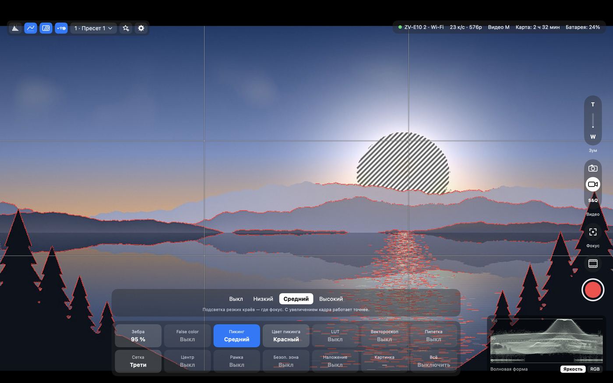
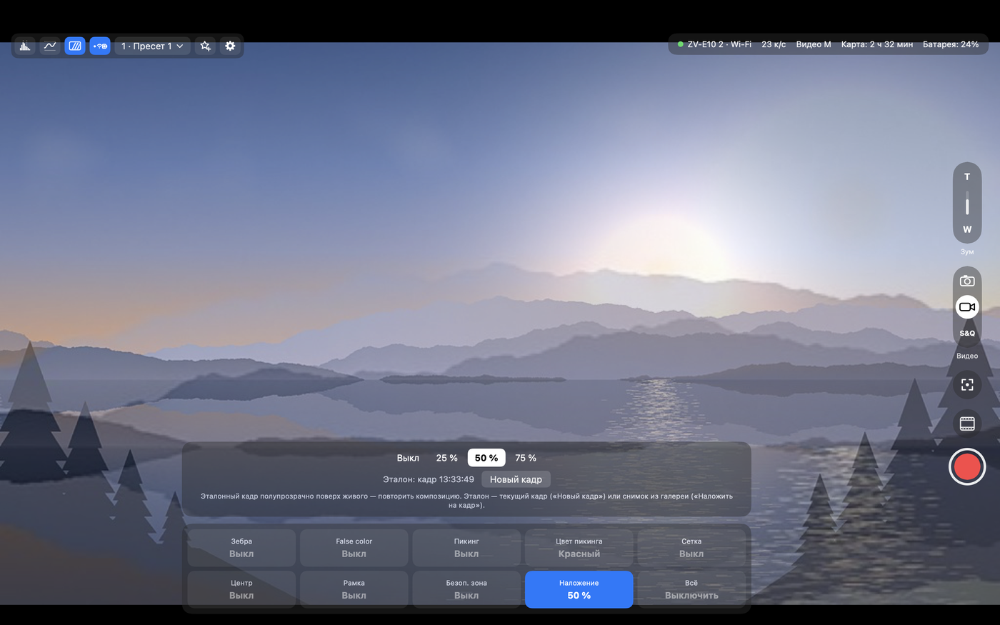
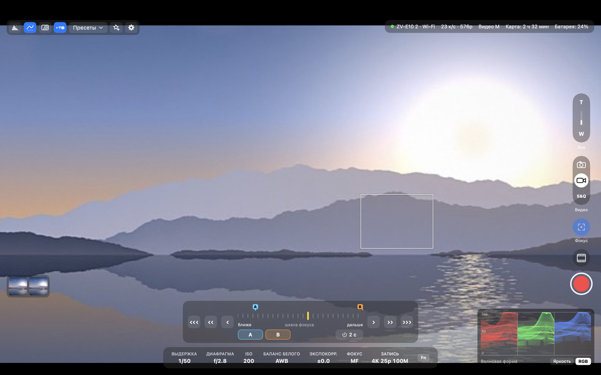
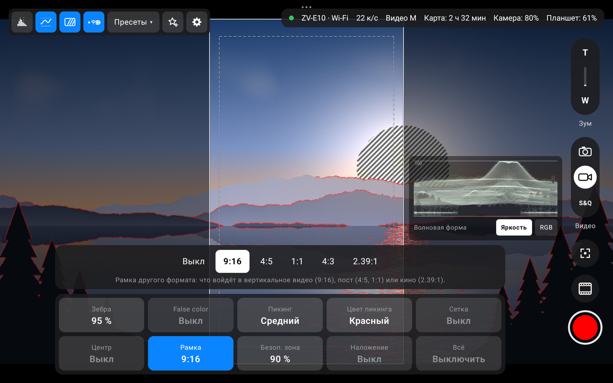
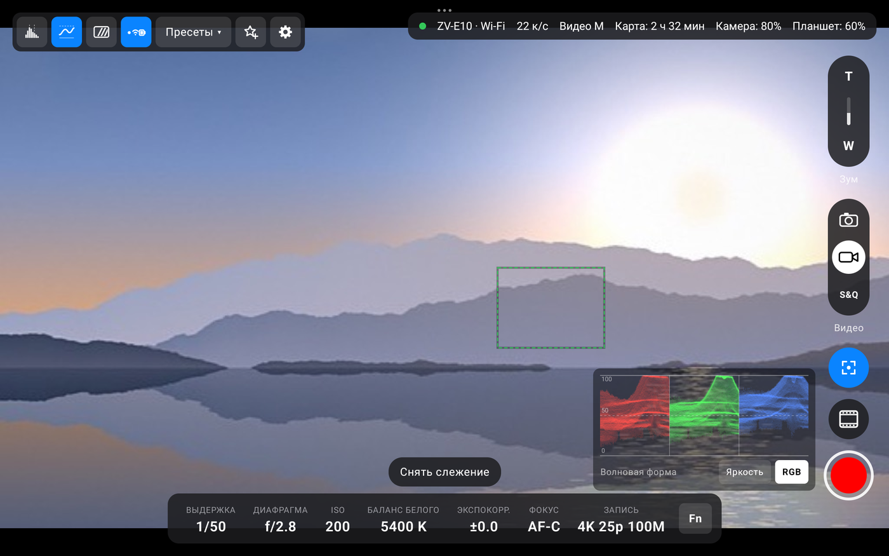

# Руководство пользователя

Sony Cam Viewer показывает живое видео с камеры Sony по USB или по Wi-Fi и даёт управлять ею с Mac или Android-планшета: менять настройки, снимать видео и фото, сохранять снимки, держать под рукой пресеты. Ниже описана программа для Mac; чем отличается планшет — в разделе [Android-планшет](#android-планшет).

- [Что нужно](#что-нужно)
- [Установка](#установка)
- [Настройка камеры](#настройка-камеры)
- [Подключение](#подключение)
- [Подключение по Wi-Fi](#подключение-по-wi-fi)
- [Главный экран](#главный-экран)
- [Меню Fn](#меню-fn)
- [Все настройки](#все-настройки)
- [Видео](#видео)
- [Фото](#фото)
- [Пресеты](#пресеты)
- [Гистограмма](#гистограмма)
- [Волновая форма](#волновая-форма)
- [Монитор: зебра, false color, пикинг, LUT, вектороскоп, пипетка, рамки](#монитор-зебра-false-color-пикинг-lut-вектороскоп-пипетка-рамки)
  - [LUT: превью S-Log и HLG](#lut-превью-s-log-и-hlg)
  - [Свои LUT](#свои-lut)
  - [Вектороскоп](#вектороскоп)
  - [Пипетка](#пипетка)
  - [Картинка: зеркало и переворот](#картинка-зеркало-и-переворот)
- [Фокус и зум с экрана](#фокус-и-зум-с-экрана)
  - [Метки фокуса](#метки-фокуса)
- [Скрытие элементов управления](#скрытие-элементов-управления)
- [Увеличение](#увеличение)
- [Настройки программы](#настройки-программы)
- [Клавиши](#клавиши)
- [Камера и программа вместе](#камера-и-программа-вместе)
- [Если что-то не работает](#если-что-то-не-работает)
- [Ограничения](#ограничения)
- [Android-планшет](#android-планшет)
  - [Кнопки громкости](#кнопки-громкости)

## Что нужно

- Mac на Apple Silicon с macOS 14 или новее.
- Камера Sony с режимом PC Remote. Какие камеры подойдут и что на них будет работать — в [README](../README.md#какие-камеры-подойдут).
- Кабель USB-C, который передаёт данные, а не только заряжает, — или Wi-Fi: роутер, к которому подключены камера и Mac, или сеть, которую раздаёт сама камера (Wi-Fi Direct).

## Установка

1. Скачайте `Sony-Cam-Viewer.dmg` со страницы [Releases](https://github.com/Scryptor/SonyCamViewer/releases/latest).
2. Откройте образ и перетащите «Sony Cam Viewer» в «Программы».
3. Программа не подписана сертификатом разработчика Apple, поэтому при первом запуске macOS её не откроет:
   - попробуйте запустить программу и закройте предупреждение;
   - откройте «Системные настройки» → «Конфиденциальность и безопасность» и внизу нажмите «Всё равно открыть».

   Или одной командой в Терминале:

   ```bash
   xattr -dr com.apple.quarantine "/Applications/Sony Cam Viewer.app"
   ```

Обновление — так же: перетащите новую версию в «Программы» и выберите «Заменить». Пресеты и настройки программы сохранятся. Если в «Программах» есть ZV-E10 Viewer — это старое имя той же программы: удалите её, настройки и пресеты у них общие и останутся.

При первом снимке в папку «Загрузки» macOS может спросить, можно ли программе туда писать. Разрешите, иначе снимки не сохранятся.

## Настройка камеры

Один раз в меню камеры:

1. MENU → Network → Smartphone Connect → Smartphone Connection: **Off**.
2. MENU → Network → PC Remote Function → PC Remote: **On**, PC Remote Cnct Method: **USB**.

Это пути для ZV-E10. На других камерах Sony пункты называются похоже, но могут лежать в других разделах меню.

Закройте Imaging Edge, «Захват изображений» и другие программы, которые работают с камерой: по USB с ней может общаться только одна программа.

## Подключение

Запустите программу и подключите камеру кабелем. Порядок не важен: программа ждёт камеру и подключается сама.


Пока камеры нет, на экране — пустой видоискатель: рамка фокуса, в ней — что программа делает и что сделать вам. Пока программа ищет камеру, уголки рамки медленно «дышат»; во время сопряжения они синие. Под рамкой — список камер: «Подключить», «Сопрячь» и «Сопрячь новую камеру…». Что мешает подключиться, написано оранжевым над списком. Ниже — «Как подключить камеру»: шаги для кабеля и для Wi-Fi. Пока программа не сопряжена ни с одной камерой или камера на кабеле не в режиме PC Remote, шаги раскрыты, иначе свёрнуты — откройте стрелкой. Wi-Fi выключен в настройках — в рамке «Подключите камеру кабелем» и кнопка «Включить Wi-Fi».

| Что на экране | Что это значит |
|---|---|
| «Подключите камеру», «Ищу камеру» | Камеры нет ни на кабеле, ни в сети. Проверьте кабель и что камера включена, а PC Remote — включён. |
| «Камера на кабеле видна, но macOS пока не даёт программе доступ к ней» | macOS ждёт ответа в окне про доступ к файлам на съемном томе — нажмите «Разрешить». См. [Если что-то не работает](#если-что-то-не-работает). |
| «Камера на кабеле, но не в режиме PC Remote» | Камера видна, но не принимает команды. Включите PC Remote (шаги — на этом же экране) и переподключите кабель. |
| «Сопряжение с камерой» | Программа ждёт, пока вы подтвердите сопряжение на камере (см. [Подключение по Wi-Fi](#подключение-по-wi-fi)). «Отмена» в рамке прерывает его. |
| «Не удалось подключиться к камере. Повтор через N с…» | Подключение сорвалось. Программа повторит сама через 2, 4, 8, затем каждые 10 секунд, пока камера подключена. |
| Видео есть, плитки настроек серые | Первые 3 секунды после подключения камера ещё не принимает настройки. Это нормально, подождите. |

Отключили кабель — программа вернётся к ожиданию и подключится снова, когда камера появится, по кабелю или по Wi-Fi.

## Подключение по Wi-Fi

Без кабеля программа находит камеру в домашней сети: камера и Mac подключаются к одному роутеру. Картинка и все функции те же, что по USB.

### Один раз: камера в сеть и сопряжение

1. На камере: MENU → Network → Wi-Fi Settings → Access Point Set. — выберите домашнюю сеть и введите пароль. ZV-E10 работает только в диапазоне 2,4 ГГц, Mac может быть в той же сети в любом диапазоне.
2. MENU → Network → PC Remote Function → PC Remote: **On**, PC Remote Cnct Method: **Wi-Fi Access Point**.
3. Запустите программу без кабеля. На экране ожидания нажмите «Сопрячь новую камеру…» под списком камер.
4. На камере: MENU → Network → PC Remote Function → **Pairing** и подтвердите подключение программы. На экране камеры программа называется «ZV-E10 Viewer» (на планшете — «ZV-E10 Viewer Android»): под этим именем камера помнит сопряжение.

Камера запоминает сопряжение, дальше программа подключается сама, как только камера появится в сети. Mac и планшет сопрягаются по отдельности, камера помнит оба.

К камерам, с которыми программа не сопряжена, она сама не стучится, а только подсказывает: «В сети есть камера — «Сопрячь» у неё в списке камер». Иначе, пока вы сопрягаете планшет, на экране камеры мог бы появиться запрос от Mac.

«Забыть сопряжение» в настройках программы забывает сопряжение со всеми камерами: у программы новое имя для камер, сама она к ним больше не подключается, а чтобы снова работать по Wi-Fi, каждую нужно сопрячь заново. Имена в списке камер остаются. Сопряжения в самих камерах при этом остаются, но к программе больше не относятся.

При первом подключении macOS спросит, можно ли программе находить устройства в локальной сети. Разрешите, иначе программа камеру не увидит. Если запретили — включите в «Системные настройки» → «Конфиденциальность и безопасность» → «Локальная сеть».

### Как программа выбирает связь

- Камера на кабеле в режиме PC Remote по USB — связь по USB, Wi-Fi не используется.
- Кабеля нет — программа ищет камеру в сети: сначала ту, к которой подключалась последней, по её прошлому адресу, потом по всей сети — среди сопряжённых камер. На подключение уходит несколько секунд.
- Камер несколько — сама программа не переключается: другую выбирают в списке камер (см. [Несколько камер](#несколько-камер)).
- Связь по Wi-Fi уже идёт, а камеру подключили кабелем (например, на зарядку) — Wi-Fi не рвётся: камера в режиме Wi-Fi по кабелю управление всё равно не даёт. Кабель программа подхватит, когда закончится связь по Wi-Fi.
- Камера на кабеле, но не в режиме PC Remote по USB — программа всё равно подключается по Wi-Fi, если может.
- Связь по Wi-Fi замерла (слабый сигнал, камеру унесли за стену) — программа не рвёт подключение и ждёт: на экране остаётся последний кадр, сверху — «Слабый сигнал Wi-Fi», а если связи нет дольше пары секунд — «Связь с камерой прервалась» и сколько это длится. Связь вернулась — картинка идёт дальше сама, без переподключения.
- Подключение всё же оборвалось — программа сразу подключается заново к той же камере («Переподключаюсь к камере…»), кадр и настройки остаются на экране, таймер записи не сбрасывается. Обычно это занимает 1–2 секунды.
- Камеры нет дольше минуты (выключили, ушла из зоны сети) — экран ожидания, программа повторяет попытки с растущей паузой: 2, 4, 8, потом каждые 10 секунд, пока камера не появится. Если в ленте есть камеры на связи, вместо этого главной становится верхняя из них (см. [Лента камер](#лента-камер)).

Камера принимает только одно подключение: пока к ней подключён планшет, Mac подключиться не сможет, и наоборот.

Подключение по Wi-Fi выключается в настройках программы: «Подключаться по Wi-Fi, когда камеры нет на кабеле».

### Несколько камер

Программа помнит все камеры, к которым подключалась, и видит те, что сейчас на кабеле или в сети. Главная камера — одна, её выбираете вы; другие камеры по Wi-Fi могут оставаться на связи в ленте (см. [Лента камер](#лента-камер)).

- **Где список.** Щелчок по имени камеры в строке состояния — сверху подсказки «Камеры». На экране ожидания — тот же список под рамкой.
- **Строка списка** — имя, как подключена («по кабелю», «Wi-Fi · 192.168.1.40») и состояние: «на связи», «в ленте», «свободна», «нужно сопряжение», «сопрягаю…», «не видна в сети», «не подключена». Справа — что можно сделать: «Подключить», «Сопрячь» или, у камеры ленты, «Сделать главной».
- **Переключить.** «Подключить» у другой камеры — программа подключается к выбранной; прежняя главная по Wi-Fi уходит в ленту и остаётся на связи, по кабелю — отключается. Камеру по Wi-Fi можно выбрать, даже когда на кабеле есть другая. Во время записи переключиться нельзя, только если главная на кабеле: камера осталась бы писать без программы.
- **Сопрячь.** У камеры, которую видно в сети, но с которой программа не сопряжена, — «Сопрячь»: на камере включите PC Remote Function → Pairing и подтвердите. «Сопрячь новую камеру…» под списком — с любой камерой в режиме Pairing, сначала с новыми.
- **Имя.** Правый клик по строке → «Переименовать…» — имя меняется прямо в строке; его же видно в строке состояния, например «Левая · Wi-Fi». Без своего имени камера называется моделью: «ZV-E10», вторая такая — «ZV-E10 2».
- **Забыть.** Правый клик → «Забыть»: камера пропадает из списка (у главной и у камер ленты этого пункта нет — камеру ленты сначала уберите из ленты). Если она в сети, она снова появится как «Камера в сети».
- **Какую подключать сама.** Когда связи нет — ту, к которой подключались последней, и после перезапуска программы тоже. Когда связь есть — сама не переключается: новые камеры просто появляются в списке. Пропала текущая — минуту программа ждёт её, потом подключается к другой доступной.
- Камеры ищутся в сети, пока список на экране: сразу и раз в 10 секунд. Камера по Wi-Fi считается видимой 30 секунд после последнего ответа.

### Лента камер

Камер по Wi-Fi на связи может быть несколько: главная — на большом экране, со всем управлением, остальные — в ленте.


- **Где.** Слева под верхней панелью — плитки всех камер на связи, у главной синяя рамка. Видна, когда камер на связи две и больше, и прячется вместе с остальными элементами.
- **Плитка** — живая картинка камеры (около 5 кадров в секунду, низкое качество — канал остаётся главной), имя, «● REC», пока камера пишет, и заряд, если осталось 20 % и меньше. «нет связи» — камера пропала, программа стучится к ней снова раз в 10 секунд.
- **Сделать главной.** Щелчок по плитке — камера сразу на большом экране: программа передаёт ей уже открытое подключение, переподключаться не нужно. Плитки при этом не двигаются: синяя рамка переходит к выбранной, прежняя главная остаётся на своём месте и на связи.
- **Поменять местами.** Перетащите плитку мышью — соседние раздвигаются, отпустили — она на новом месте. Главную тоже можно перетащить. Порядок запоминается: плитки идут в порядке знакомых камер. Камера, к которой программа подключилась впервые, встаёт последней; знакомая — на своё место среди остальных, в том числе убранная из ленты и возвращённая.
- **Во время записи** переключаться можно: камера продолжает писать в ленте, а вернётесь к ней — таймер записи идёт с того же места. Нельзя, только если главная на кабеле: её подключение закрылось бы.
- **Добавить в ленту.** В списке камер правый клик по сопряжённой камере → «В ленту». Камера по Wi-Fi, с которой вы переключились на другую, попадает в ленту сама.
- **Убрать.** Правый клик по плитке → «Убрать из ленты»: подключение закрывается, и сама программа к этой камере больше не подключается. Там же — «Сделать главной».
- **Главная пропала** — минуту программа ждёт её; не вернулась — главной становится верхняя камера ленты на связи.
- В ленте — только камеры по Wi-Fi и не больше четырёх камер вместе с главной. Камера на кабеле бывает только главной. Лента запоминается: после перезапуска программа сама подключит её камеры.

### Группа: связанные камеры

Камеры в ленте работают в одном из двух режимов:

| Режим | Цепочки на плитках | Что происходит |
|---|---|---|
| **Каждая сама по себе** | не горят | у каждой камеры свои настройки. Щёлкните по плитке — камера на большом экране, настраивайте её; вернулись к другой — у той всё как было |
| **Группа** | горят синим | связанные камеры и главная — группа: изменения на главной уходят и на камеры группы |

- **Связать.** Цепочка в правом нижнем углу плитки: горит синим — камера в группе и повторяет за главной. Ещё раз — отвязать. Связали камеру — главная тоже входит в группу: на её плитке появляется цепочка без кнопки, главная ведёт группу. Группа одна: связали камеру с главной не из группы — главная входит в ту же группу, и за ней повторяют все камеры группы.
- **Что повторяют:** каждое изменение настроек на главной — меню Fn, строка значений, «Все настройки», колесо и стрелки, ползунок температуры (камера не в «Цвет. темп.» сама переходит в него), режим записи, «Фото / Видео / S&Q»; «Применить» пресета; кнопку записи — запуск и остановку (медленная камера не потеряет «стоп», нажатый сразу после «пуска»). Пишется то же значение. «Посмотреть», снимок, цифровое увеличение и качество превью — только у главной.
- **Если камера не может** — значения нет среди тех, что она даёт выбрать, настройку сейчас менять нельзя или камера не подтвердила, — на ней пропускается, а вверху слева появляется сообщение: «Не удалось на «C»: ISO 51200». Камера без связи ничего не получает, а вернувшись, сама не догоняет.
- **Главной стала камера группы** (щелчок по её плитке или главная пропала) — группу ведёт она, камеры группы повторяют уже за ней, прежняя главная из группы — тоже.
- **Главной стала камера не из группы** — группа ждёт: её камеры ни за кем не повторяют, а цепочки на их плитках горят вполсилы. Вернулись на камеру группы — повторяют снова. Нажали приглушённую цепочку — главная входит в группу, и вся группа повторяет за ней.
- **Свои настройки у камеры из группы.** Связь значения не выравнивает: связанная камера получает только следующие изменения на главной, а что на ней уже стоит, то и остаётся — до тех пор, пока ту же настройку не поменяют на главной. Чтобы настроить одну камеру группы отдельно: отвяжите её, щёлкните по её плитке и настройте, вернитесь на камеру группы и свяжите её снова — или, не возвращаясь, нажмите цепочку на плитке прежней главной: тогда группу поведёт только что настроенная камера.
- Отдельных исключений нет: связанная камера повторяет все настройки сразу, а не «всё, кроме экспозиции».
- Группа запоминается и после перезапуска. «Убрать из ленты» выводит камеру из группы; осталась в группе одна камера — группы нет.

### Чем Wi-Fi отличается от USB

- Превью — те же 25 кадров в секунду. Если сеть не успевает, кадров меньше, это видно по счётчику в строке состояния (см. [Главный экран](#главный-экран)).
- Снимки скачиваются медленнее: RAW+JPEG (около 30 МБ) от нажатия до файла — примерно 12–14 секунд через роутер, около 20 — в режиме Wi-Fi Direct, по USB — около 4.
- По Wi-Fi камера быстрее расходует батарею.
- Превью в полном качестве (1024×576) — около 14 Мбит/с, это почти потолок Wi-Fi камеры. В режиме «Авто» (так по умолчанию), когда сигнала не хватает, программа сама переходит на 640×360: картинка мельче, зато идёт плавно, — у счётчика кадров в строке состояния «360p» вместо «576p». Сигнал наладился — через 15–30 секунд возвращается полное качество. Щелчок по счётчику кадров открывает выбор качества превью: «Авто», «1024×576» — всегда полное (на слабом Wi-Fi картинка может дёргаться), «640×360» — всегда облегчённое (вдвое меньше трафика, плавнее, но мельче). То же — в настройках программы. По USB камера всегда отдаёт полное превью, и выбор там неактивен.
- Если картинка дёргается: поставьте камеру ближе к роутеру (в режиме Wi-Fi Direct — Mac ближе к камере), выключите на Mac AirDrop и Handoff — они уводят Wi-Fi Mac на свои каналы, — и по возможности подключите Mac к роутеру кабелем или по 5 ГГц.

### Без роутера: Wi-Fi Direct

Когда роутера нет, например на улице, камера может сама раздать сеть.

1. На камере: MENU → Network → PC Remote Function → PC Remote Cnct Method: **Wi-Fi Direct**. Камера покажет имя своей сети (`DIRECT-…`) и пароль.
2. Подключите Mac к этой сети. Интернета на Mac, пока он подключён к камере, не будет.
3. Программа найдёт камеру сама, в строке состояния после имени камеры будет «Wi-Fi Direct», а в подсказке о подключении — что сигнал идёт между Mac и камерой.

Устройство, уже сопряжённое через роутер, подключается без нового сопряжения. Превью — 23–25 кадров в секунду, RAW+JPEG скачивается дольше, чем через роутер: около 20 секунд от нажатия до файла.

## Главный экран


- **Вверху слева** — кнопки гистограммы, волновой формы, «Монитора» (зебра, false color, пикинг, LUT, вектороскоп, пипетка, сетка, рамки, зеркало) и строки состояния, кнопка пресетов со списком, ☆+, который сохраняет настройки — в текущий пресет или новым, и ⚙ — настройки программы. Справа от них на несколько секунд появляются сообщения: «Сохранено в «Вечер»», «Применяю «Вечер»…», «Снимок не удался: …».
- **Слева под кнопками** — лента камер, когда на связи две камеры и больше (см. [Лента камер](#лента-камер)).
- **Вверху справа** — строка состояния. Она видна всегда, когда видны остальные элементы. Кнопка с точкой и Wi-Fi вверху слева закрепляет её: пока кнопка горит синим (так по умолчанию), строка остаётся на экране и когда элементы спрятаны — клавишей H или сами. Незакреплённая прячется вместе с элементами. В строке:
  - во время записи — в начале «● REC» с таймером;
  - точка: зелёная — камера готова, оранжевая — идёт подключение;
  - имя камеры и способ связи: «ZV-E10 · USB» или «Левая · Wi-Fi» (своё имя дают в списке камер, без него — модель). Щелчок — подсказка: сверху список камер (см. [Несколько камер](#несколько-камер)), ниже — камера и её прошивка, а по Wi-Fi ещё адреса камеры и Mac и уровень сигнала Wi-Fi;
  - счётчик кадров и разрешение превью, например «25 к/с · 576p» (в фоторежиме — по форме кадра). Щелчок — подсказка: сверху выбор качества превью по Wi-Fi («Авто», «1024×576», «640×360»), что сейчас и что делает выбранное, ниже — сводка: это кадры трансляции, а не съёмки, и самая долгая пауза между кадрами за последние 10 секунд. На запись это число не влияет: камера пишет видео на карту со своей частотой. Обычно между кадрами около 40 мс, паузы дольше 200 мс заметны как рывок;
  - режим съёмки, например «Видео M» или «M»;
  - сколько осталось на карте: в видеорежиме — время записи, в фоторежиме — число кадров (если снимки пишутся на карту);
  - в фоторежиме — папка на Mac, куда сохраняются снимки;
  - заряд батареи.
- **Внизу по центру** — строка значений, как на дисплее камеры: выдержка, диафрагма, ISO, баланс белого, экспокоррекция, фокус, в видеорежиме ещё режим записи (например, «4K 25p 100M»), в фоторежиме — формат снимка. Клик по значению открывает меню Fn сразу на этой настройке, клик по «Fn» — просто меню.
- **Справа** — переключатель «Фото / Видео / S&Q»: три значка в капсуле — фотоаппарат, видеокамера и S&Q, у выбранного режима белый круг, под капсулой — его название. Над ним — «T» и «W», если камера даёт управлять зумом, под ним — кнопка фокуса касанием, ниже — кнопки съёмки: в видео и S&Q — стоп-кадр и запись, в фоторежиме — спуск (см. [Фокус и зум с экрана](#фокус-и-зум-с-экрана)).
- **Внизу слева** — лента последних снимков. Гистограмма — там, куда её поставили; по умолчанию слева внизу над лентой.
- **Внизу справа** — пока картинка увеличена: мини-карта, во сколько раз увеличено, и ✕ (см. [Увеличение](#увеличение)).

Если кадры с камеры запаздывают дольше секунды, сверху появляется «Слабый сигнал Wi-Fi». Если их нет дольше нескольких секунд, картинка приглушается, а по центру — «Связь с камерой прервалась» (по USB — «Нет картинки с камеры») и сколько это длится; по Wi-Fi через 10 секунд — ещё и совет, что попробовать. Программа ждёт и вернёт картинку, как только камера ответит.

### Отладка

«Вид → Отладка» (⌥⌘D) или кнопка «Отладка…» в подсказке о подключении открывает поверх экрана панель со всем, что программа знает о связи и камере, по вкладкам:

- **Связь** — как подключена камера, адреса, сигнал Wi-Fi Mac (уровень, шум, скорость, канал), отклик камеры, поток превью, сколько было провалов связи и восстановлений, почему оборвалось в последний раз.
- **Превью** — кадров в секунду, размер кадра, качество и прогноз частоты на высоком, паузы между кадрами, время запроса кадра.
- **Камера** — модель, прошивка, режим, запись, батарея, перегрев, карта, служебные настройки. У камер нового поколения Sony — ещё версия кода камеры, списки подписей, которые она прислала (названия Creative Look, кнопок, FTP-серверов и т. п.), и таблицы объектива: расстояния для положений фокуса.
- **Свойства** — все свойства камеры с кодами и значениями, с поиском.
- **Журнал** — подключения, провалы связи, переподключения, смены качества и нажатия записи с ответом камеры, с точным временем.

«Скопировать» кладёт в буфер обмена всё это текстом — удобно, чтобы прислать разработчику. Панель работает и на экране ожидания: там видно, куда программа стучится и что отвечает камера. Серийный номер камеры она не показывает. Но списки подписей камеры нового поколения показаны в ней целиком, а в списках кнопок или FTP-серверов бывают названия, которые вводили вы: просмотрите отчёт перед отправкой. На планшете та же панель открывается долгим нажатием на плашку состояния или пунктом «Отладка» в настройках (⚙).

## Меню Fn


Меню Fn устроено как в самой камере: сетка 2×6 и над ней лента значений выбранной настройки.

- **Открыть:** клавиша F, кнопка «Fn» или клик по значению в строке внизу.
- **Выбрать настройку:** клик по плитке. Выбранная плитка подсвечена синим.
- **Изменить значение:** клик по значению в ленте, стрелки ← → или колесо мыши над меню.
- **Закрыть:** F, Esc или клик по видео.

| Ряд | Видеорежим | Фоторежим |
|---|---|---|
| Верхний | выдержка, диафрагма, ISO, баланс белого, экспокоррекция, фокус | то же |
| Нижний | зона фокуса, замер, профиль, стиль, запись, «Все» | зона фокуса, замер, DRO, формат, пропорции, «Все» |

Программа всегда показывает то значение, которое стоит на камере. Пока камера не подтвердила новое, на плитке видно прежнее значение и крутится индикатор. Обычно подтверждение приходит примерно за 0,6 секунды. Если камера значение не приняла, индикатор через две-три секунды пропадёт, а значение останется прежним.

Серая плитка значит, что в текущем режиме камера эту настройку менять не даёт. Например, в режиме M экспокоррекция работает только с ISO AUTO. Если уже выбранная настройка стала недоступной, в ленте появится надпись «Камера сейчас не даёт менять …».

### Баланс белого

Когда выбран баланс белого, справа от ленты появляются ещё два элемента:

- **Цветовая температура** — ползунок, 2500–9900 K. Над ним — температура при текущем режиме: в режиме «Цвет. темп.» — заданная, например «7400 K»; в пресетах — примерная, например «≈ 5600 K» у «Дневной»; в AWB, «Под водой» и «Свой» — «авто». Ползунок работает в любом режиме: сдвинули — камера переходит в режим «Цвет. темп.» с выбранной температурой.
- **Сдвиг A–B / G–M** — квадрат с точкой. По горизонтали слева B (синее), справа A (янтарнее); по вертикали сверху G (зеленее), снизу M (пурпурнее). Тяните точку: записывается та ось, вдоль которой тянули, а при движении по диагонали — обе. Шаг — четверть деления, как в камере. «Сброс» возвращает 0 по обеим осям.

Камера хранит сдвиг отдельно для каждого режима баланса белого. Сдвиг, настроенный в AWB, не переносится на «Дневной».

Температуру автобаланса и готовых режимов баланса белого («Дневной», «Тень» и других) камера не сообщает: она отдаёт только ручную температуру, и ту — в любом режиме, хотя действует она лишь в «Цвет. темп.». Поэтому для пресетов программа показывает примерные значения: «Дневной» ≈ 5600 K, «Тень» ≈ 7000 K, «Облачно» ≈ 6000 K, «Лампа» ≈ 3200 K, «Вспышка» ≈ 5500 K, флуоресцентные — ≈ 3000, 4000, 5000 и 6500 K. В режиме «Цвет. темп.» на плитке баланса белого и в строке значений видна сама температура, как на экране камеры.

## Все настройки


Плитка «Все» в меню Fn открывает полный список по группам:

| Группа | Настройки |
|---|---|
| Экспозиция | режим съёмки, выдержка, диафрагма, ISO, экспокоррекция, замер, DRO / HDR |
| Фокус | режим фокуса, зона фокуса |
| Цвет и картинка | баланс белого, цветовая температура, сдвиги A–B и G–M, творческий стиль (у камер с Creative Look — он), профиль изображения |
| Видео | формат видео, параметры записи |
| Фото | размер снимка, соотношение сторон, формат снимка, качество JPEG |
| Камера | батарея, остаток на карте, температура камеры |

Клик по строке открывает под ней ленту значений. Серые строки сейчас только для чтения. Закрыть панель — Esc или клик по видео.

## Видео

- **Запись.** Красная кнопка справа начинает запись на карту камеры, кнопка с квадратом останавливает. Пока камера не подтвердила, вокруг кнопки крутится дуга (красная — запускаю, белая — останавливаю), слева от неё — «Запуск записи…» или «Остановка…»; круг становится квадратом, только когда камера начала писать. Пока идёт запись, вокруг картинки — красная рамка, как у мониторов, а вверху справа — «● REC» с таймером; и то и другое видно, даже когда элементы управления спрятаны. Рамку можно выключить или настроить в настройках программы (⌘, → «Запись»): толщина 1–12 pt, яркость 30–100 %, мигание.

  Если запись не началась или не остановилась, кнопка «мотает головой», а слева от неё, на месте «Запуск записи…», 5 секунд видно почему:
  - «Камера не начала запись» (при остановке — «Камера не остановила запись») — камера не подтвердила за 6 секунд или нажатие до неё не дошло;
  - «Камера занята — запись не началась» или «Камера не приняла нажатие — …» — камера отклонила нажатие, и за следующие 2,5 секунды запись так и не пошла;
  - «Камера начала запись и сразу остановила» — запись, начатая из программы, кончилась в первые 3 секунды;
  - «Камера ещё не ответила на прошлое нажатие» — прошлое нажатие ещё в пути, например при провале связи.

  Пока кнопка ждёт камеру или показывает такое сообщение, элементы не прячутся. Запись, которую остановили кнопкой на камере или камера сама, — «Запись остановлена на камере» в строке состояния. Каждое нажатие с ответом камеры записывается в журнал панели отладки.
- **Стоп-кадр.** Кнопка с кадром киноплёнки над кнопкой записи или клавиша S сохраняет текущий кадр превью в папку из настроек программы. Экран коротко вспыхивает, и кадр уменьшается и улетает в ленту снимков. Имя файла — «Кадр ГГГГ-ММ-ДД ЧЧ-ММ-СС.jpg». Запись при этом не прерывается. Стоп-кадр всегда сохраняется на Mac, даже если снимки настроены «только на карту».

Стоп-кадр — это кадр превью, а не полноразмерный снимок: 1024×576 пикселей (при сниженном качестве превью по Wi-Fi — 640×360).

Во время записи режим («Фото / Видео / S&Q») не переключается.

### Замедленная и ускоренная съёмка (S&Q)

Переключатель справа — «Фото / Видео / S&Q», как кнопка MODE на камере. В режиме S&Q камера снимает с одной частотой, а ролик пишет с другой: снятое со 100 кадрами в секунду в ролике 25p идёт в 4 раза медленнее, снятое с 1 кадром в секунду — в 25 раз быстрее.

- **Частота ролика и битрейт** — «Запись» в строке внизу, как в обычном видео.
- **Частота съёмки** (у ZV-E10 — 1, 2, 4, 8, 15, 25, 50, 100 кадров в секунду) выбирается только на камере: MENU → S&Q Settings → Frame Rate. Камера не сообщает её по кабелю и менять не даёт: удалённых кнопок MENU и OK у неё нет.
- **В строке состояния** в S&Q видно частоту съёмки и что будет со скоростью, например «100 к/с · ×4 замедл.». Щелчок — подробности. Частоту программа узнаёт по самой длинной выдержке, которую разрешает камера: выдержка не может быть длиннее кадра. В режимах S&Q P и A выдержку выбирает камера, и частоту не видно.

Запись и стоп-кадр в S&Q работают так же, как в обычном видео.

### Режим записи

Формат видео, частота кадров и битрейт выбираются одним нажатием: значение «Запись» в строке внизу или плитка «Запись» в меню Fn открывают ленту режимов обоих форматов. У ZV-E10 в системе PAL это:

| Формат | Режимы |
|---|---|
| 4K | 25p 100M, 25p 60M |
| HD | 100p 100M, 100p 60M, 50p 50M, 50p 25M, 25p 50M, 25p 16M |

Камера сама даёт выбирать частоту и битрейт только внутри текущего формата. Поэтому, если выбран режим другого формата (например, HD 100p из 4K), программа сначала переключает формат, а потом выставляет частоту и битрейт — около трёх секунд. Пока камера переключается, она молча пропускает новые команды, поэтому программа пишет по одной и после каждой смотрит, что на камере; пропущенную команду она повторяет.

Передумали, пока камера переключается, — камера придёт к последнему выбору. Стрелки ← → и колесо мыши листают режимы по порядку: быстрые шаги складываются (три шага — три позиции), а камера сразу идёт к итоговому режиму, без промежуточных. Строка «Формат видео» во «Всех настройках» тоже меняет режим целиком: 4K 25p 100M → HD даст HD 25p 50M — та же частота с самым высоким битрейтом.

Во время записи режим не меняется. DRO в видеорежиме — только во «Всех настройках»: его место в меню Fn занимает режим записи.

## Фото


### Переключение в фоторежим

Нажмите значок фотоаппарата в переключателе справа. Буква режима сохраняется: видео M становится M, видео A — A и так далее. Из автоматического или сюжетного режима камера переходит в P. Если камера не даёт перейти в нужный режим, ничего не происходит.

В фоторежиме превью принимает пропорции снимка: при 1:1 оно квадратное.

### Снимок

Нажмите белую кнопку спуска или пробел. Программа делает то же, что палец на кнопке камеры:

1. Нажимает спуск наполовину. В режимах автофокуса камера до секунды наводится.
2. Нажимает до конца и отпускает.
3. Если снимок нужно сохранить на Mac, забирает из камеры все его файлы. При RAW+JPEG это два файла.

Палец или курсор закрывает кнопку, поэтому отклик — вокруг неё и на всём кадре: нажатая кнопка вдавливается, вокруг проступает кольцо, принятое нажатие расходится волной, а в момент, когда камера сработала, экран на миг темнеет, как у беззеркалки. Пока камера занята, вокруг кнопки — дуга, слева — что сейчас происходит: «Фокусировка…», «Снимаю…», «Загрузка 42 %» (по Wi-Fi дуга показывает, сколько файла уже пришло; по USB на Mac — просто крутится). Готовый снимок появляется в ленте с «пружинкой». Пробел даёт тот же отклик, что и щелчок.

Программа знает по формату снимка, сколько файлов ждать (RAW+JPEG — два), и отпускает спуск сразу после последнего.

Файлы называются так же, как на камере, например `DSC02053.JPG`. Если файл с таким именем в папке уже есть, новый получит имя `DSC02053 (2).JPG`: старые файлы не затираются.

Куда сохранять, выбирается в настройках программы (⌘,):

| Настройка | Что происходит |
|---|---|
| На Mac и на карту камеры | файлы скачиваются в папку на Mac и остаются на карте |
| Только на Mac | файлы скачиваются в папку на Mac, на карту ничего не пишется |
| Только на карту | снимок остаётся на карте, на Mac ничего не скачивается |

Программа сообщает камере место сохранения, когда вы его меняете и перед снимком. При подключении она его не трогает.

### Просмотр после съёмки


Снимок показывается поверх видео в тот момент, когда камера сработала, и ровно столько секунд, сколько задано в настройках; справа — кольцо обратного отсчёта. Сначала это кадр превью той секунды, когда камера снимала. Что дальше, задаётся в настройках:

- **Загруженный снимок** — как только файл скачан, он плавно встаёт на место кадра; отсчёт при этом не начинается заново. Если файл качается дольше, чем идёт просмотр (RAW+JPEG по Wi-Fi), просмотр закрывается вовремя, загрузку показывает кнопка спуска, а снимок появится в ленте.
- **Кадр с камеры** — кадр так и остаётся до конца просмотра.

Если снимки сохраняются только на карту, показывается кадр с камеры.

Пока загруженный снимок качается, внизу видно «Загрузка 42 %». Закрыть просмотр раньше — клик, Esc или пробел. Кнопки внизу: «Показать в Finder» и «Открыть».

### Лента снимков и галерея

Последние снимки и стоп-кадры этой сессии видны внизу слева: до шести миниатюр и «+N» — сколько ещё.

- Клик по миниатюре открывает галерею на этом снимке, по «+N» — на седьмом.
- Правый клик — «Показать в Finder», «Открыть» или «В Корзину».

Галерея — на весь экран: сверху «3 из 12», «Наложить на кадр», «Показать в Finder», «Открыть» и «Удалить», снизу — имя файла, что это («Стоп-кадр 1024×576», «Снимок 6000×4000», «RAW + JPEG»), размер файла и время, и лента всех снимков сеанса, текущий — в белой рамке.

- **Листать:** ← →, смахивание двумя пальцами по трекпаду (один снимок за жест), колесо мыши, кнопки ‹ › по краям, щелчок по миниатюре в ленте. Слева — новее, справа — старше.
- **Увеличить:** щипок на трекпаде или двойной щелчок (вписать ↔ 2,5× в этой точке), сдвигать — мышью или двумя пальцами. Если увеличить сильнее экрана, программа догружает снимок в полном разрешении — так видно резкость. Пока снимок увеличен, листание стоит.
- **Щелчок по снимку** прячет и возвращает верх и ленту.
- **Закрыть:** ×, Esc или пробел.
- **Удалить:** «Удалить» вверху справа или ⌘⌫. Снимок пропадает из галереи и ленты, его файлы (у RAW + JPEG — оба) уходят в Корзину. Галерея переходит на снимок, вставший на его место, а если удалили последний — закрывается. Внизу на 6 секунд появляется плашка «… — в Корзине» с кнопкой **«Вернуть»** (или ⌘Z): файлы возвращаются в папку, снимок — на своё место в ленте, галерея открывается на нём. Позже снимок можно достать из Корзины в Finder. Удаляется только копия на Mac: если снимок сохранялся и на карту, там он остаётся — карту в режиме PC Remote камера программе не открывает.

Новый снимок или стоп-кадр, пока галерея открыта, её не сбивает: открытый снимок остаётся на экране. После перезапуска программы лента пустая, сами файлы остаются в папке.

## Пресеты

Пресет — сохранённый набор настроек камеры, который возвращается одной кнопкой.

- **Свои у фото и у видео.** У каждого режима свой список: в фото видны пресеты фото, в видео — пресеты видео, S&Q пользуется пресетами видео. Переключили камеру — сменился и список, а с ним номера и цифры 1–9. Без камеры виден список того режима, в котором она была в последний раз.
- **Выбрать.** Кнопка пресетов вверху слева. На ней — текущий пресет, например «2 · Вечер», иначе «Пресеты». Клик открывает список «Пресеты для фото» или «Пресеты для видео и S&Q»: у каждого пресета номер, имя и что он ставит, например «1/50 · f/2.8 · ISO 800 · 3200 K · AF-C». Галочка — у тех, что стоят на камере. Клик по строке применяет пресет. Цифры 1–9 применяют пресет с этим номером сразу, без списка.
- **Текущий и «изменён».** Текущий — пресет, который вы в этом режиме последним применили, создали или сохранили. Поменяли на камере то, что он ставит, — на кнопке появляется оранжевая точка, а в списке у него вместо галочки «изменён». Что именно поменяли, видно в подсказке кнопки: «ISO 800 → 1600 · 1/50 → 1/100». Считается только то, что камера сейчас даёт менять: выдержка в режиме A — не изменение.
- **Сохранить в пресет.** Когда текущий изменён, внизу списка появляется «Сохранить в «Вечер»», под ним — что изменилось. Клик записывает в «Вечер», как камера настроена сейчас; имя и выключенные настройки остаются.
- **Новый пресет.** «Новый пресет…» в списке. Программа спросит имя (подставлено «Пресет N» — можно сразу печатать своё) и покажет, для какого режима он и что войдёт: «Для видео и S&Q: 1/50 · f/2.8 · ISO 800 · …». Новый встаёт в конец списка этого режима.
- **☆+** вверху слева сохраняет одним нажатием. Если текущий пресет изменён, программа спросит, куда: «Сохранить в «Вечер»» (Enter) или «Новый пресет…». Если не изменён — сразу новый пресет.
- **Настроить.** «Настроить…» в списке или «Вид → Пресеты…» (⇧⌘P) открывает окно «Пресеты».

### Окно «Пресеты»

Слева — список пресетов режима камеры, «Пресеты для фото» или «Пресеты для видео и S&Q», справа — выбранный. Всё сохраняется сразу, кнопки «Сохранить» нет. Переключили камеру — в окне список другого режима, выбран его текущий пресет.


- Имя правится прямо в поле.
- Порядок меняется перетаскиванием в списке. Номер пресета — это и его цифра 1–9.
- «Применить» ставит пресет на камеру. «Посмотреть» — быстрый просмотр: пока кнопку держите, окно прозрачно, а пресет стоит на камере, и видно, как с ним выглядит картинка; отпустите — то, что ещё не записано, не пишется, а камера возвращается как была. Понравилось — «Применить». «Взять с камеры» заменяет значения пресета тем, как камера настроена сейчас, — то же, что «Сохранить в «…»» в списке. Если выбран изменённый текущий пресет, под кнопками написано, что поменяли на камере. «Дублировать» кладёт копию следом за пресетом. «Удалить…» сначала спрашивает. «Новый пресет» под списком делает новый пресет с камеры, и его имя сразу можно править.
- Ниже — настройки пресета группами: экспозиция, цвет и картинка, фокус. Флажок решает, менять ли настройку: выключенная не применяется, но значение помнит, и если включить её снова, оно на месте.
- Значение выбирается из того, что камера даёт выбрать сейчас, с теми же подписями, что в меню Fn. Камера при этом не меняется — только пресет. Если камера выбрать не даёт (она не на связи или в другом режиме), значение видно, но выбрать его нельзя.
- Цветовая температура действует, только если баланс белого в пресете — «Цвет. темп.» или если баланс белого пресет не меняет. Её можно выбрать из 2500–9900 K, даже когда камера сейчас в другом режиме.
- После «Посмотреть» камера возвращает всё, что поменял пресет. Одно исключение: сдвиг баланса белого камера хранит отдельно для каждого режима, и если пресет переключал режим баланса белого, в том режиме остаётся сдвиг пресета.

В пресет входят:

- баланс белого, цветовая температура, сдвиги A–B и G–M;
- ISO, экспокоррекция, выдержка, диафрагма;
- замер, DRO;
- режим и зона фокуса;
- творческий стиль, Creative Look (у камер, у которых он есть), профиль изображения.

Сохраняются только те из них, которые камера в момент сохранения даёт менять. Творческий стиль и Creative Look — разные настройки: числа значений у них совпадают, а смысл другой, поэтому пресет со стилем на камере с Creative Look эту настройку пропускает, и наоборот. Режим съёмки, формат видео и фото и параметры записи в пресет не входят.

Как применяется пресет:

- Настройки ставятся по одной, совпадающие значения пропускаются, выключенные в пресете не трогаются.
- Цветовая температура и сдвиги ставятся только после баланса белого: камера хранит их для каждого режима отдельно. Если баланс белого не применился, они не трогаются.
- Экспокоррекция ставится после ISO.
- В конце появляется итог: «применено 12 из 14. Не удалось: …». Обычно «не удалось» значит, что в текущем режиме камера эту настройку не даёт менять.

Пресеты хранятся в настройках программы на этом Mac и переживают переустановку.

## Гистограмма

Кнопка с графиком вверху слева включает гистограмму яркости кадра: тени слева, света справа. Высота столбцов сжата, чтобы были видны и небольшие «хвосты» у краёв.

Гистограмму можно утащить мышью куда угодно, у края она прилипает к отступу. Место запоминается и переживает смену размера окна и перезапуск. Включённая гистограмма не прячется вместе с остальными элементами и видна при открытом меню Fn — там она нужнее всего. Прячется только под просмотром снимка и галереей.

Пунктир делит шкалу на три равные части. Под графиком — что в кадре:

| Строка | Что значит |
|---|---|
| Тени, Полутона, Света | сколько точек кадра в каждой трети шкалы, в процентах |
| Провалы | сколько точек почти чёрные: детали в тенях потеряны |
| Средняя | средняя яркость кадра; её же показывает треугольник под графиком |
| Пересвет | сколько точек упёрлись в белое: детали в светах потеряны |

От 1 % провалы и пересвет становятся жёлтыми, а у того края графика появляется жёлтая полоса. Немного пересвета бывает нормой — окно, лампа, блик. Если жёлтое там, где важны детали (лицо, небо), уменьшите экспозицию.

Шкала идёт от чёрного до белого той картинки, которую отдаёт камера. В видеорежиме камера отдаёт превью с белым на уровне 234 из 255, в фоторежиме — 255. Программа учитывает это сама: пересвет всегда упирается в правый край.

Гистограмма строится по кадру превью, а не по RAW, поэтому это ориентир, а не точный замер.

## Волновая форма

Вторая кнопка вверху слева — волновая форма, как у мониторов: по горизонтали — кадр слева направо, по вертикали — яркость точек каждого столбца кадра, снизу чёрное, сверху белое. По ней видно, где в кадре пересвет и провалы и как светлое и тёмное разложено по кадру: лицо в середине кадра — яркое пятно в середине графика.

- Линии — 0, 50 и 100 %. 100 % — белое превью, как у гистограммы: в видеорежиме 234 из 255, в фоторежиме 255. Что выше линии 100 % — пересвет.
- Под графиком — переключатель: «Яркость» — один след, «RGB» — RGB-парад: красный, зелёный и синий отдельно, рядом. Парад показывает цветовой сдвиг: у белого и серого три канала на одной высоте.
- Волновую форму, как и гистограмму, можно утащить куда угодно; по умолчанию она справа внизу, левее кнопок съёмки. Место запоминается. Она не прячется вместе с остальными элементами.
- На кнопки справа (зум, режим, запись) ни волновая форма, ни гистограмма не ложатся: отпустили панель над ними — она встаёт левее, на той же высоте.

Строится по всему кадру превью, а не по увеличенной части.

## Монитор: зебра, false color, пикинг, LUT, вектороскоп, пипетка, рамки



Третья кнопка вверху слева (кадр с полосами) или клавиша M открывает меню «Монитор» — внизу, на месте строки значений, как меню Fn. Сверху — значения выбранного инструмента и что он делает, ниже — 14 плиток в две строки по семь. Щелчок по плитке выбирает её, щелчок по выбранной — включает или выключает (с тем значением, что было в прошлый раз). Стрелки ← → и колесо мыши листают значения выбранной плитки. Четырнадцатая плитка, «Всё — Выключить», выключает все инструменты — в том числе LUT и зеркало, так что «всё выключено» значит «картинка такая, какой её даёт камера» — и помнит, что было включено; выбранный файл LUT, переключатель «Помощь — по картинке с LUT» и масштаб вектороскопа остаются. Инструменты помнятся между запусками.

| Плитка | Значения | Что делает |
|---|---|---|
| Зебра | Выкл, 100 %, 95 %, 70 % кожа | полосы наискось там, где кадр ярче порога: 100 % — пересвет, 95 % — почти пересвет, 70 % — полоса 65–75 %, где обычно светлая кожа |
| False color | Выкл, Вкл | кадр в условных цветах по яркости, сверху — легенда: фиолетовый — провал, синий — глубокие тени, зелёный — средне-серый (18 % серого), розовый — кожа (на ступень светлее серого), жёлтый — почти белое, красный — пересвет; остальное — серым |
| Пикинг | Выкл, Низкий, Средний, Высокий | подсветка резких краёв — где фокус; чем выше уровень, тем больше краёв подсвечено |
| Цвет пикинга | Красный, Жёлтый, Белый, Синий | цвет подсветки |
| LUT | Выкл, Авто, S-Log3 Cine, S-Log3, S-Log2, HLG, Свой | превью S-Log и HLG с обычным контрастом и цветом, только на экране; на плитке — «Авто: S-Log3» или «Авто: нет», у «Свой» — имя файла; см. [LUT](#lut-превью-s-log-и-hlg) и [Свои LUT](#свои-lut) |
| Вектороскоп | Выкл, Вкл | цвета кадра на круге: оттенок и насыщенность; см. [Вектороскоп](#вектороскоп) |
| Пипетка | Выкл, Вкл | яркость и цвет в точке кадра; пока она включена, касание кадра ставит её, а не фокус; см. [Пипетка](#пипетка) |
| Сетка | Выкл, Трети, Квадраты | для композиции |
| Центр | Выкл, Вкл | крестик в центре кадра |
| Рамка | Выкл, 9:16, 4:5, 1:1, 4:3, 2.39:1 | что войдёт в вертикальное видео, пост или кино: снаружи притемнено, сетка — внутри рамки |
| Безоп. зона | Выкл, 90 %, 80 % | пунктир на 90 или 80 % кадра (или рамки): внутри надписи не обрежутся |
| Наложение | Выкл, 25 %, 50 %, 75 %, 100 % | эталонный кадр полупрозрачно поверх живого — повторить композицию |
| Картинка | Как есть, Зеркально, Вверх ногами, Зеркально + 180° | зеркало и переворот картинки на экране; на плитке — «—», «Зеркало», «180°», «Зеркало 180°»; см. [Картинка](#картинка-зеркало-и-переворот) |
| Всё — Выключить | — | выключает все инструменты, в том числе LUT и зеркало; что было включено, запоминается |

Быстрые клавиши: Z — зебра, P — пикинг, C — false color, L — LUT, V — вектороскоп, I — пипетка (включить или выключить).

Всё это считается по кадру превью на экране программы: камера о нём не знает, на запись и снимки не влияет. Проценты — доли белого превью, как у гистограммы и волновой формы. LUT, зеркало и переворот меняют сам кадр на экране; снимки, стоп-кадры, эталон наложения и сама камера остаются как есть.

**Пикинг и увеличение.** Превью — 1024×576 точек, поэтому для точного фокуса пикинг удобно включать вместе с увеличением. При увеличении программа пересчитывает видимую часть кадра бикубически в размер экрана и ищет края уже на ней: на 8× подсветка — тонкая линия по середине края, а не квадраты по 8 точек.

**Пикинг в темноте.** Края ищутся по перепадам яркости превью, а в тёмной сцене перепады малы: подсвечено меньше, на «Низком» — почти ничего. Помогают «Высокий» уровень и свет. Порог в тенях тот же, что в светах: ниже — и подсвечивался бы шум матрицы.

### LUT: превью S-Log и HLG

В S-Log и HLG камера отдаёт плоское, бледное превью: контраст и цвет по нему не оценить. LUT показывает его так, как оно выглядело бы в обычном видео Rec. 709. Это только картинка на экране программы: снимки, стоп-кадры, эталон наложения, запись и настройки камеры не меняются.

| Вариант | Что это |
|---|---|
| Выкл | картинка такая, какую отдаёт камера |
| Авто | LUT по профилю изображения камеры (см. ниже); на плитке — «Авто: S-Log3», а если для профиля LUT нет, — «Авто: нет» |
| S-Log3 Cine | S-Log3 с цветовым охватом S-Gamut3.Cine |
| S-Log3 | S-Log3 с охватом S-Gamut3 |
| S-Log2 | S-Log2 с охватом S-Gamut |
| HLG | HLG с охватом BT.2020 |
| Свой | файл `.cube`, который вы добавили ([Свои LUT](#свои-lut)); на плитке — его имя |

**«Авто».** LUT выбирается по профилю изображения камеры (PP): PP7 — S-Log2, PP8 — S-Log3 Cine, PP9 — S-Log3, PP10 — HLG; остальные профили и «Выкл» — LUT нет. Это заводские гаммы Sony: если профиль в камере перенастроен, «Авто» ошибётся — выберите LUT вручную в той же плитке. Камеры, которые сами называют гамму и цветовой режим профиля, программа слушает по ним, а не по номеру профиля: S-Log2, S-Log3 (с охватом S-Gamut3 или S-Gamut — «S-Log3», с другим — «S-Log3 Cine») и любая HLG. Сменили профиль на камере — LUT меняется почти сразу, а плитка показывает, какой LUT выбран сейчас.

**«Помощь — по картинке с LUT».** Переключатель в полосе над плитками, пока выбрана плитка «LUT»; по умолчанию включён. Гистограмма, волновая форма, вектороскоп, зебра, false color, пикинг и пипетка считаются по той же картинке, что вы видите, и белое в них — 255: после LUT чёрное и белое снова на краях шкалы. Выключите — они считаются по сигналу камеры (повёрнутому, если включено зеркало), а белое — как раньше: 234 в видео, 255 в фото. «Всё — Выключить» этот переключатель не трогает.

**Что стоит знать.**
- Превью — 8-битный JPEG 1024×576, поэтому картинка с LUT — ориентир для глаза, а не цветокоррекция: в тенях и светах лога градаций мало, и LUT их не прибавит.
- Встроенные LUT программа считает сама по открытым формулам Sony и ITU; готовых файлов других программ в ней нет. Значение канала превью (0–255) она принимает за код камеры (0–1023): 18 % серого в S-Log3 — код 420, то есть 105 из 255. Что превью в S-Log несёт именно такие уровни, на настоящей камере ещё не измерено. Если картинка с LUT выглядит слишком контрастной или бледной, выключите LUT или выберите другой вручную.
- Пока LUT и зеркало выключены (или «Авто» не нашёл LUT), картинка не обрабатывается и программа ничего на это не тратит.
- Клавиша L включает и выключает LUT.

### Свои LUT

Можно добавить свой LUT — файл 3D LUT в формате `.cube`: размер от 2 до 65 точек на ребре, `DOMAIN_MIN` / `DOMAIN_MAX` и `LUT_3D_INPUT_RANGE` понимаются; 1D LUT не принимаются. Свой LUT получает значения каналов превью так же, как встроенные: 0–255 как 0–1.

- **Добавить.** В плитке «LUT» выберите «Свой», нажмите «Добавить LUT…» и выберите файл. Файл `.cube` можно и просто перетащить на окно программы (картинки при этом, как и раньше, становятся эталоном наложения). Программа проверяет файл, копирует его в свою папку (`~/Library/Application Support/Sony Cam Viewer/LUTs/`) и сразу выбирает; исходный файл остаётся где был.
- **Имя** — имя файла без `.cube`. Файл с тем же именем заменяет прежний. Всего можно держать до 12 файлов: тринадцатый не добавится — «Своих LUT не больше 12 — удалите ненужный».
- **Выбрать.** Имена файлов стоят в полосе над плитками, выбранный выделен белым, на плитке «LUT» написано его имя. «Удалить» убирает выбранный файл из папки программы (исходный не трогает), и LUT выключается.
- **Если файл не подошёл,** в строке сообщений вверху написано почему: «Нужен 3D LUT в формате .cube» (это 1D LUT или не `.cube`), «В файле 35 936 строк данных, а нужно 35 937», «Не удалось прочитать файл». Прежний выбор при этом остаётся. Когда файл добавлен, там же — «LUT «Look» добавлен».

### Вектороскоп

Показывает, какие цвета есть в кадре и насколько они насыщены. Каждая точка кадра ложится на круг: направление от центра даёт оттенок, расстояние от центра — насыщенность. Серый и чёрно-белое собираются в центре, цветовой сдвиг виден как облако, уехавшее в сторону. Плоскость — цветоразностные Cb (вправо) и Cr (вверх) по Rec. 709; яркость места на панели — сколько точек кадра там легло, цвет — оттенок этого места.

- **Панель.** Плитка «Вектороскоп» (или клавиша V) включает плавающую панель 176×176 pt. По умолчанию она слева сверху, под верхней панелью; её можно утащить мышью куда угодно, место запоминается. С лентой камер панель встаёт правее ленты, а у колонки кнопок справа — левее неё. Как гистограмма и волновая форма, она не прячется вместе с остальными элементами, а в просмотре снимка и в галерее прячется вместе с гистограммой.
- **Сетка.** Круг по краю плоскости, тонкий крест, шесть меток цветных полос 75 % (R, Mg, B, Cy, G, Yl) — туда ложатся цвета стандартной тестовой таблицы — и наклонная линия тона кожи под углом 123° от оси вправо против часовой стрелки: тон светлой кожи лежит вдоль неё.
- **Масштаб.** Щелчок по панели переключает ×1 и ×2; «×2» в углу горит, когда выбран он. При ×1 до края круга — полностью насыщенный цвет, при ×2 — только четверть пути, поэтому бледные цвета лога видны крупнее. Метки полос 75 % при ×2 лежат за краем и не рисуются.
- **По какой картинке.** По той же, что у остальной помощи: с LUT или без (переключатель «Помощь — по картинке с LUT»), повёрнутой, если включено зеркало.

### Пипетка

Показывает яркость и цвет в одном месте кадра. Плитка «Пипетка» (или клавиша I) ставит на кадр метку — кружок с перекрестием — и рядом табличку в две строки:

```
47 % · кожа
R 182 · G 140 · B 121
```

- **Процент** — яркость (веса Rec. 709, как у гистограммы) в процентах от белого превью, то есть по той же шкале, что у волновой формы: 100 % — белое (234 в видео, 255 в фото и с LUT).
- **R, G, B** — цвет, 0–255.
- **Зона** — имя зоны false color для этой яркости, по той же таблице, что у легенды: «провал», «тени», «18 % серого», «кожа», «почти белое», «пересвет». Между зонами подписи нет.
- Считается **среднее по квадрату 5×5 точек** вокруг метки (у края кадра квадрат обрезается краем), по той же картинке, что вы видите, — с LUT и зеркалом. Подписи обновляются не чаще пяти раз в секунду, чтобы цифры можно было прочитать.

Пока пипетка включена, **щелчок по кадру ставит пипетку, а не фокус** — что бы ни горело на кнопке «Фокус»: она приглушается, а в её подсказке сказано почему. Выключили пипетку — щелчок снова ставит фокус. Метку можно тащить мышью, щипок по-прежнему увеличивает. При первом включении метка стоит в центре кадра, место помнится до выхода из программы. У правого края кадра табличка встаёт слева от метки, у нижнего — поднимается.

### Наложение кадра: повторить сцену



Эталонный кадр лежит полупрозрачно поверх живого видео. По нему кадр выстраивается так же, как в прошлый раз. Пригодится, когда нужно:

- доснять сцену на другой день: камера, штатив и человек — на тех же местах;
- снять дубль или перебивку с той же точки, после того как камеру сдвигали;
- сделать «до и после», таймлапс по дням, серию товара на одном фоне;
- повторить ракурс второй камерой или кадр с раскадровки, референса, прошлой съёмки.

**Как пользоваться.**

1. Включите наложение: плитка «Наложение» в меню «Монитор» или клавиша O на Mac. Эталоном сразу станет эталон прошлого раза, а если его нет — текущий кадр.
2. Выберите эталон:
   - **«Новый кадр»** — то, что сейчас в живом видео;
   - **«Из файла…»** — любая картинка: на Mac — окно выбора файла (JPEG, PNG, HEIC, TIFF…), а можно просто перетащить картинку на окно программы; на планшете — системный выбор файла: галерея, «Загрузки», облако;
   - **«Наложить на кадр»** вверху галереи — снимок или стоп-кадр этого сеанса.
3. Двигайте камеру, зум, свет, людей, пока картинки не совпадут: где они расходятся, всё двоится.

**Панель наложения.** Пока наложение включено, на кадре — панель (по умолчанию справа вверху; её можно утащить куда угодно, место запоминается):

- **миниатюра эталона** — щелчок (касание) по ней прячет эталон и возвращает его. Так удобно сравнивать «было / стало»: спрятали — живой кадр без эталона, вернули — с ним. На Mac то же делает клавиша O. Спрятанный эталон — притушенная миниатюра с перечёркнутым глазом;
- **ползунок** — непрозрачность эталона от 5 до 100 %. 50 % — чтобы сравнивать, 25 % — чтобы эталон не мешал, 100 % вместе со «спрятать» — чистое мигание «эталон ↔ живой кадр»;
- **«Новый кадр»** и **«Из файла…»** — сменить эталон, **✕** — выключить наложение.

В меню «Монитор» у плитки «Наложение» — быстрые ступени 25, 50, 75 и 100 % и те же кнопки «Новый кадр» и «Из файла…»; непрозрачность с ползунка видна на плитке как есть, например «40 %».

**Подробности.**

- Эталон хранится в данных программы: переживает перезапуск, а снимок или файл, из которого его взяли, можно удалить. Новый эталон заменяет прежний; на панели видно, какой сейчас: «кадр 13:33:49» или имя файла.
- Картинка из файла уменьшается до 2048 точек по длинной стороне; поворот из EXIF учитывается — фото с телефона ложится как надо.
- Спрятанный эталон — не настройка: после перезапуска, нового эталона или повторного включения он снова виден.
- С цифровым увеличением эталон увеличивается вместе с кадром: совпадение удобно проверять на деталях.
- Картинка другой формы (3:2 на видео 16:9, вертикальная) ложится по ширине кадра, лишнее обрезано.
- Всё это только на экране программы: камера о наложении не знает, в запись и снимки оно не попадает.
- Вместе с наложением можно включить сетку и центр: по ним проще выровнять горизонт и середину.

### Картинка: зеркало и переворот

У плитки «Картинка» четыре варианта:

| Вариант | Значение на плитке | Зачем |
|---|---|---|
| Как есть | — | картинка такая, какую отдаёт камера |
| Зеркально | Зеркало | снимать себя: экран стоит лицом к вам, и картинка как в зеркале |
| Вверх ногами | 180° | камера на риге или подвесе перевёрнута |
| Зеркально + 180° | Зеркало 180° | то и другое сразу |

Меняется то, что видно на экране, и всё, что с этим связано:
- **картинка и помощь:** гистограмма, волновая форма, вектороскоп, зебра, false color, пикинг и пипетка считаются по повёрнутой картинке, поэтому волновая форма идёт слева направо, как видно;
- **касание для фокуса** переводится из экрана в кадр камеры: точка AF встаёт под палец, а рамки фокуса камеры и отметка касания рисуются там, где предмет виден на экране;
- **эталон наложения** ложится с тем же поворотом, что и кадр; **увеличение, пипетка, мини-карта, главная плитка ленты, просмотр после съёмки и полёт стоп-кадра** работают с уже повёрнутой картинкой.

Не меняются файлы (снимки, стоп-кадры, эталон наложения), плитки других камер в ленте (они показывают картинку как есть) и сама камера. Зеркало одно на всю программу, а не у каждой камеры; оно запоминается между запусками, и «Всё — Выключить» его выключает.

## Фокус и зум с экрана



Это команды камере, а не экрану программы. Кнопки появляются, только если камера их знает.

**Фокус касанием.** Кнопка с уголками рамки и подписью «Фокус» под переключателем режима: пока она горит, щелчок по кадру ставит туда фокус. Рамки фокуса самой камеры видны всегда, как на её экране, — зелёные, когда фокус найден, слежение — пунктиром. Выбрали точку — кнопку можно выключить: начатое слежение продолжается и его рамка видна, а щелчки по кадру его уже не собьют; снять слежение — «Снять слежение» над строкой значений. При включении кнопки открывается подсказка: как это работает и строка «Сейчас» — что сделает касание при нынешней зоне фокуса, например «зона «Широкая» — касание экрана камеры: слежение». Галочка «Больше не показывать» убирает её при включении; открыть снова — правый щелчок по кнопке на Mac, долгое нажатие на планшете. Как именно ставится фокус — решает зона фокуса камеры:

- «Точка» или «Зона» — рамка AF переезжает в эту точку, как джойстиком;
- «Широкая» и другие — программа «касается» экрана камеры в этой точке, и камера делает то же, что при касании своего экрана: фокус или слежение (Touch Function в меню камеры). Слежение снимает «Снять слежение» над строкой значений. Если касание экрана в камере — спуск затвора или выключено, программа экрана не касается: так случайно не сделать снимок;
- в ручном фокусе касание фокус не ставит — для него шкала фокуса. Рамка «Точки» остаётся видна, но белой: по ней камера уже не фокусирует;
- пока Clear Image Zoom или цифровой зум больше ×1,0, камера сама ставит зону «Центр» и не даёт касаться экрана — фокус касанием вернётся вместе с зумом ×1,0.

Щелчок, пока открыто меню, только закрывает меню. С увеличением точка ставится там, куда щёлкнули на увеличенной картинке. С зеркалом или переворотом (плитка «Картинка») точка AF тоже встаёт под щелчок: программа сама переводит её в кадр камеры.

Пока включена «Пипетка», щелчок по кадру ставит пипетку, а не фокус: кнопка «Фокус» приглушена, а в её подсказке об этом отдельная жёлтая строка. Выключили пипетку (клавиша I) — щелчок снова ставит фокус.

**Зум.** «T» и «W» над переключателем режима — как рычажок зума камеры: держите, и камера зумирует, отпустили — стоп. Работает с объективом с электроприводом зума (у ZV-E10 — китовый PZ 16-50), а с обычным объективом — Clear Image Zoom или цифровой зум камеры, если он включён в её меню. С объективом с приводом зум сначала идёт оптикой — меняется и диафрагма в строке значений (у PZ 16-50 — от f/3.5 до f/5.6), а за длинным концом продолжается Clear Image Zoom, если он включён в меню камеры. Между «T» и «W» — где зум на шкале, под капсулой — масштаб Clear Image Zoom («×1,3»), пока он больше ×1,0. Клавиши: держать T — к теле, W — к широкому.

**Шкала фокуса.** В ручном фокусе (MF) над строкой значений появляется шкала: «‹‹‹ ‹‹ ‹» — ближе на 7, 3 и 1 шаг, «› ›› ›››» — дальше. Шкалу можно тянуть, как кольцо фокуса: влево — ближе, вправо — дальше; колесо мыши над ней — по шагу. Жёлтая метка — где фокус сейчас, если камера это сообщает. Вместе с пикингом и увеличением — ручной фокус по экрану. Если камера сообщает данные объектива, под линейкой подписаны расстояния («0,5 м», «1 м», «2 м», «∞»), а у жёлтой метки — текущее расстояние; у ZV-E10 данных объектива нет, и расстояний на шкале тоже. Под линейкой — метки фокуса A и B, см. ниже.

### Метки фокуса

Две метки, A и B, запоминают положение фокуса и плавно переводят к нему фокус за выбранное время — например, с одного предмета на другой за 4 секунды без рывка. Метки стоят под линейкой шкалы фокуса (она видна в ручном фокусе, если камера отдаёт положение фокуса) в строке `[A] [B] [⏱ 2 с]`.

- **Запомнить.** Пустая метка подписана «A+». Наведите фокус на предмет и нажмите её: метка запомнила положение, а на линейке появился значок с её буквой. Если у камеры есть данные объектива, на кнопке написано расстояние: «A 1,2 м».
- **Перевести.** Нажатие на заданную метку («A») переводит фокус к ней за выбранное время. Пока фокус едет, кнопка заливается по доле пути и показывает значок «стоп»; нажать её ещё раз — остановить. Перевод кончается вспышкой кнопки и итогом на 3 секунды вместо подписи «шкала фокуса»: «Фокус у метки A», «Дальше камера не двигает» (три шага подряд в одну сторону ничего не сдвинули — например, у края шкалы) или «Не успел за 3 с».
- **Время** — кнопка «⏱ 2 с»: каждое нажатие переключает 0 → 1 → 2 → 4 → 8 секунд по кругу. «0 с» — как можно быстрее. Идущий перевод едет с прежним временем.
- **Запомнить заново и стереть.** Правый щелчок на метке (на планшете — долгое нажатие) открывает «Запомнить здесь» и «Стереть».
- **Карточка «Метки фокуса».** Когда шкала с метками появляется в первый раз за запуск, над ней открывается карточка: что делают «A+» и «A», время перевода и правый щелчок. В ней галочка «Больше не показывать». Открыть карточку снова — правый щелчок на кнопке времени → «Как работают метки фокуса…» (на планшете — долгое нажатие на кнопке времени).

**Что останавливает перевод:** любое ручное движение фокуса (кнопки шагов 1, 3, 7, перетаскивание шкалы, колесо мыши), выход из ручного фокуса, касание едущей метки, потеря связи с камерой и смена объектива — если камера о ней сообщает.

**Где живут метки.** У каждой камеры свои. Они остаются, пока программа запущена, и переживают обрыв связи с той же камерой; время перевода тоже помнится за камерой. Смена объектива, о которой камера сообщила, стирает обе метки (время остаётся). После выхода из программы метки пропадают.

**Как фокус едет.** У камер с абсолютным фокусом программа каждые 0,1 с записывает в камеру точку плавной кривой от начала к цели, и фокус встаёт в метку с точностью до 0,5 % шкалы. У ZV-E10 абсолютного фокуса нет: фокус ведут те же шаги «ближе / дальше», что у кнопок на шкале, поэтому он встаёт в метку с точностью до шага объектива: ближе, чем на шаг, камера не подойдёт.

## Скрытие элементов управления

- **Само.** Через несколько секунд без движения мыши элементы прячутся, любое движение мыши возвращает их. Сколько ждать — от 1 до 30 секунд, по умолчанию 3, — и выключить автоскрытие можно в настройках программы.
- **Вручную.** Клавиша H прячет элементы, на пару секунд появляется подсказка «Элементы скрыты · H — показать». Вернуть их можно только клавишей H, движение мыши не помогает.

Пока открыто меню Fn, меню «Монитор», «Все настройки», подсказка из строки состояния, список пресетов или окошко сохранения пресета, просмотр снимка или галерея, а также пока кнопка записи ждёт камеру или показывает отказ, элементы сами не прячутся. Гистограмма, волновая форма, вектороскоп, метка пипетки, зебра, пикинг и рамки «Монитора», плашка увеличения, красная рамка записи и «● REC» не прячутся никогда, строка состояния — если она закреплена кнопкой с точкой и Wi-Fi вверху слева.

## Увеличение

Картинку можно увеличить цифровым образом — только на экране, камера об этом не знает: снимки, стоп-кадры и запись — всегда весь кадр, гистограмма — по всему кадру.

- **Щипок** на трекпаде — увеличение вокруг курсора, до 8×. За пределами 1× и 8× картинка сопротивляется и возвращается пружиной; отпустили ниже 1,05× — снова весь кадр.
- **⌘=, ⌘−, ⌘0** (меню «Вид»: «Увеличить», «Уменьшить», «Без увеличения») — ступени 1×, 1,5×, 2×, 3×, 4×, 6×, 8× вокруг того же центра.
- **Сдвиг** — перетаскивание мышью или прокрутка двумя пальцами. Картинка не отходит от краёв.

Пока картинка увеличена, в правом нижнем углу — мини-карта всего кадра с рамкой видимой части (щелчок или перетаскивание по ней сдвигают картинку), «2,4×» и ✕ — вернуться к 1×. Плашка видна и при скрытых элементах.

Увеличение сохраняется при переключении фото / видео / S&Q, во время записи и при смене размера окна; сбрасывается, когда связь с камерой закончилась.

Как программа снижает потерю качества:

- пока увеличено от 1,5×, превью по Wi-Fi в режиме «Авто» держится в полном размере 1024×576 до последнего: снижается до 640×360, только если на полном не набирается и 6 кадров в секунду;
- видимая часть кадра пересчитывается бикубически (Catmull-Rom) в размер экрана — края заметно чётче обычного растяжения. Это нагружает процессор примерно на 20 % одного ядра, только пока картинка увеличена.

Чудес нет: превью — 1024×576 точек, на 4× на экране четверть его ширины. Для проверки резкости лучше снимок в галерее — там догружается полное разрешение.

## Настройки программы

Открываются кнопкой ⚙ вверху слева, сочетанием ⌘, или через пункт настроек в меню программы.

| Настройка | По умолчанию |
|---|---|
| Куда сохранять снимки | на Mac и на карту камеры |
| Папка на Mac | «Загрузки» |
| Показывать снимок после съёмки | включено |
| Сколько показывать | 3 секунды (1–10) |
| Во время просмотра показывать | загруженный снимок |
| Подключаться по Wi-Fi, когда камеры нет на кабеле | включено |
| Качество превью по Wi-Fi: «Авто» (1024×576, а когда сигнала не хватает — 640×360), «1024×576» или «640×360» — то же, что по щелчку на счётчике кадров | «Авто» |
| Сопряжённые камеры: «Забыть сопряжение» — у программы новое имя для камер, все придётся сопрячь заново; имена в списке камер остаются | — |
| Скрывать элементы управления без движения мыши | включено |
| Через | 3 секунды (1–30) |
| Красная рамка вокруг картинки во время записи | включено |
| Толщина рамки | 3 pt (1–12) |
| Яркость рамки | 70 % (30–100) |
| Мигать | выключено |

Рядом с настройками рамки — образец: как она будет выглядеть. Гистограмма, волновая форма, инструменты «Монитора» (в том числе LUT, зеркало и вектороскоп), фокус касанием и закрепление строки состояния включаются кнопками на экране и запоминаются сами, как и места гистограммы, волновой формы и вектороскопа. Свои LUT лежат в папке программы (`~/Library/Application Support/Sony Cam Viewer/LUTs/`). Метки фокуса и место пипетки в настройки не пишутся: они живут, пока программа запущена.

## Клавиши

| Клавиша | Что делает |
|---|---|
| F | открыть или закрыть меню Fn |
| M | открыть или закрыть меню «Монитор» |
| Z, P, C | включить или выключить зебру, пикинг, false color |
| L, V, I | включить или выключить LUT, вектороскоп, пипетку |
| O | наложение кадра: выключено — включить, включено — спрятать или показать эталон |
| T, W (держать) | зум к теле, к широкому — если камера даёт управлять зумом |
| ← → | предыдущее или следующее значение выбранной настройки в меню Fn или «Монитор»; в галерее — соседний снимок |
| 1–9 | применить пресет с этим номером |
| ⇧⌘P | окно «Пресеты» |
| ⌥⌘D | панель отладки |
| Пробел | снимок в фоторежиме; закрыть просмотр снимка или галерею |
| S | стоп-кадр в видеорежиме |
| H | скрыть или показать элементы управления |
| Esc | закрыть меню, панель, просмотр снимка или галерею |
| ⌘⌫ | в галерее — снимок в Корзину |
| ⌘Z | вернуть удалённый снимок, пока видна плашка «Вернуть» |
| ⌘= ⌘− ⌘0 | увеличить, уменьшить картинку, вернуть весь кадр |
| ⌘, | настройки программы |

Буквы работают и в русской раскладке: F/А, S/Ы, H/Р, M/Ь, Z/Я, P/З, C/С, L/Д, V/М, I/Ш, O/Щ, T/Е, W/Ц.

## Камера и программа вместе

- Кнопки и колёса на камере работают и при подключённой программе. Изменения сразу видны в программе.
- Подключаясь, программа включает в камере приоритет управления с компьютера. Иначе часть настроек, например диафрагма, была бы недоступна.
- Программа не меняет настройки, которых вы не касались. Исключения — место сохранения снимков (его она сообщает камере перед снимком) и качество превью по Wi-Fi, которое программа переключает сама (см. [Чем Wi-Fi отличается от USB](#чем-wi-fi-отличается-от-usb)).
- LUT, зеркало, вектороскоп и пипетка — только на экране программы, камера о них не знает. Метки фокуса двигают фокус объектива и больше ничего в камере не меняют.

## Если что-то не работает

**Программа не видит камеру.**
- После установки или обновления программы macOS спрашивает, можно ли ей читать «файлы на съемном томе». Пока вы не нажали «Разрешить», камеры для программы нет. Если камера на кабеле, а macOS её не отдаёт дольше 5 секунд, программа подскажет это на экране ожидания. Если окна нет — «Системные настройки» → «Конфиденциальность и безопасность» → «Файлы и папки» → Sony Cam Viewer → «Съемные тома». Программа не подписана сертификатом Apple, поэтому macOS спрашивает это заново после каждого обновления.
- Проверьте, что камера включена, а кабель передаёт данные: попробуйте другой кабель или порт.
- Закройте Imaging Edge, «Захват изображений», «Фото» и другие программы, которые могли занять камеру.
- Переподключите кабель.

**«Камера на кабеле, но не в режиме PC Remote».** Включите PC Remote и способ подключения USB (см. [Настройка камеры](#настройка-камеры)) и переподключите кабель.

**Настройка серая или «Камера сейчас не даёт менять …».** В текущем режиме камеры эта настройка недоступна. Примеры:
- выдержка в режиме A;
- экспокоррекция в M с ручным ISO;
- цветовая температура во «Всех настройках», пока не выбран режим «Цвет. темп.» (ползунок в меню Fn переключит режим сам);
- формат снимка в видеорежиме.

**Значение не меняется.** Первые 3 секунды после подключения настройки не принимаются, подождите. Если значение возвращается назад, камера его отклонила, обычно из-за режима.

**Щелчок по кадру не ставит фокус.** Если горит «Пипетка», щелчок ставит её, а не фокус: выключите пипетку (клавиша I). Другие причины — в разделе [Фокус и зум с экрана](#фокус-и-зум-с-экрана): ручной фокус, Clear Image Zoom больше ×1,0.

**«Авто: нет» у LUT или картинка с LUT странная.** «Авто» работает по профилю изображения камеры: PP7 — S-Log2, PP8 и PP9 — S-Log3, PP10 — HLG; на остальных профилях LUT нет, и это не ошибка. Если профиль в камере перенастроен, выберите LUT вручную в той же плитке. Картинка с LUT слишком контрастная или бледная — выключите LUT: он построен в предположении, что превью в S-Log несёт те же уровни, что запись, а на настоящей камере это ещё не измерено.

**Нет меток «A+» и «B+» под шкалой фокуса.** Метки есть только в ручном фокусе и только если камера отдаёт положение фокуса. Переведите камеру в MF: шкала с метками появится.

**Программа не находит камеру по Wi-Fi.**
- Камера и Mac должны быть в одной сети. Проверьте, что камера подключена к роутеру и в ней выбран PC Remote Cnct Method: Wi-Fi Access Point.
- macOS могла запретить программе доступ к локальной сети: «Системные настройки» → «Конфиденциальность и безопасность» → «Локальная сеть».
- В гостевой сети роутера устройства обычно не видят друг друга. Подключите камеру и Mac к основной сети.

**«В сети есть камера, но программа с ней не сопряжена».** Нажмите «Сопрячь» у неё в списке камер и подтвердите на камере, см. [Подключение по Wi-Fi](#подключение-по-wi-fi).

**«Камера найдена, но пока не отвечает».** Камеру видно в сети, но она трижды подряд не ответила: обычно она ещё держит прошлое подключение, которое оборвалось без прощания, например, если пропала сеть. Это проходит за 1–2 минуты. Если нет — выключите и снова включите на камере PC Remote.

**«В сети есть камера — «Сопрячь» у неё в списке камер».** Программа видит камеру, но не сопряжена с ней: ещё не сопрягалась, камеру забыли («Забыть» в списке камер или «Забыть сопряжение» в настройках) или в самой камере сбросили сопряжения. Сопрягите заново, см. [Подключение по Wi-Fi](#подключение-по-wi-fi).

**Картинка по Wi-Fi дёргается.** Посмотрите на счётчик кадров и на самую долгую паузу в его подсказке. Поставьте камеру ближе к роутеру. Диапазон 2,4 ГГц делят соседские сети и микроволновка, так что помехи бывают и при хорошем сигнале.

**Картинка замерла, «Нет картинки с камеры…».** Подождите несколько секунд: программа повторяет запросы сама. Если картинка не вернулась, переподключите кабель.

**«Снимок не удался: …».** Камера не сделала снимок или не отдала файл за 10 секунд. Проверьте, что камера в фоторежиме и на карте есть место, если снимок пишется на карту, и попробуйте ещё раз.

**Снимки не появляются в папке.** Проверьте в настройках, что выбрано сохранение на Mac и папка существует. Если macOS спрашивала разрешение на доступ к папке и вы запретили, разрешите в «Системные настройки» → «Конфиденциальность и безопасность» → «Файлы и папки».

**macOS не открывает программу.** См. [Установка](#установка).

**Быстро садится батарея.** Превью по USB расходует заряд. В меню камеры есть пункт USB Power Supply: с ним камера берёт питание по кабелю. Хватит ли мощности порта Mac, зависит от порта и кабеля.

## Ограничения

- По USB и по Wi-Fi камера отдаёт только превью: 1024×576 в видеорежиме, в фоторежиме зависит от пропорций снимка (при 1:1 — 1024×1024), до 25 кадров в секунду. Видео лучшего качества дают режим камеры USB Streaming или захват по HDMI, но это уже без этой программы.
- Экспонометр (M.M.) в ручном режиме камера не отдаёт.
- Температуру автобаланса и готовых режимов баланса белого камера не сообщает, программа показывает «авто» и примерные значения.
- По Wi-Fi к камере может быть подключено только одно устройство. Mac в режиме Wi-Fi Direct остаётся без интернета: у него один Wi-Fi.
- Во время записи видео нельзя снять фото и переключить режим.
- Зумом программа управляет у объективов с электроприводом зума (у ZV-E10 — китовый PZ 16-50) и Clear Image Zoom камеры. Зум с механическим кольцом — только руками на объективе: с таким объективом «T» и «W» ведут Clear Image Zoom. Пока он больше ×1,0, фокус касанием недоступен — так решает камера. Увеличение двумя пальцами или щипком — цифровое и только на экране.
- Зебра, false color, пикинг, волновая форма, вектороскоп и пипетка считаются по превью 1024×576 (в фоторежиме — по форме кадра), а не по записываемому видео: это ориентир, как и гистограмма. В тёмной сцене пикинг подсвечивает меньше краёв.
- LUT и «Авто» следуют заводским профилям камеры (PP7 — S-Log2, PP8 и PP9 — S-Log3, PP10 — HLG; у камер, которые сообщают гамму и цветовой режим профиля, — этим свойствам): перенастроенный профиль «Авто» не узнает. Превью — 8-битный JPEG, поэтому картинка с LUT — ориентир для глаза, а не цветокоррекция. LUT построен в предположении, что превью в S-Log несёт те же уровни, что запись; на настоящей камере это ещё не измерено.
- Метки фокуса у камер без абсолютного фокуса (у ZV-E10) переводят фокус шагами «ближе / дальше», поэтому он встаёт в метку с точностью до шага объектива. Метки не сохраняются между запусками.
- Программа сделана на ZV-E10 с прошивкой 2.00: на других камерах Sony подписи значений берутся у самой камеры и из справочника Sony, и всё же редкое значение может остаться как `#N`, а на камерах до 2020 года, скорее всего, не будут меняться выдержка, ISO и экспокоррекция. Подробно — в [README](../README.md#какие-камеры-подойдут).

## Android-планшет


| «Монитор» на планшете | Фокус касанием и зум |
|---|---|
|  |  |

Пока интерфейс сделан для планшета: на телефоне программа запустится, но раскладка рассчитана на большой экран. Версия под телефоны — в ближайшее время.

Приложение для Android повторяет программу для Mac: всё, что описано выше, работает и там. Установка — в [README](../README.md#установка-на-android). Чем оно отличается:

| На Mac | На планшете |
|---|---|
| H — спрятать или показать элементы | касание видео |
| элементы прячутся через заданное время без движения мыши | без касаний, время настраивается так же |
| «Вид → Пресеты…» (⇧⌘P) — окно «Пресеты» | долгое нажатие на кнопку пресетов или «Пресеты…» в настройках — панель «Пресеты»; порядок меняют кнопки «Выше» и «Ниже» |
| клик по снимку в ленте — галерея | касание; в галерее — смахивание влево-вправо, двойное касание и щипок, смахивание вниз или «Назад» — закрыть |
| «Удалить» в галерее — в Корзину Mac | «Удалить» — в корзину планшета: система хранит файлы 30 дней и прячет их из «Загрузок»; на Android 10, где корзины нет, файлы удаляются насовсем, когда закроется «Вернуть» |
| правый клик по снимку в ленте | долгое нажатие — открыть файл в другой программе |
| правый клик по камере в списке камер | долгое нажатие — «Переименовать…» (окошко с именем), «В ленту» / «Убрать из ленты» и «Забыть» |
| щелчок по плитке ленты — главная; правый клик — меню | касание; долгое нажатие — «Сделать главной», «Убрать из ленты» |
| перетащить плитку — поменять место | долгое нажатие и вести пальцем: меню закрывается, плитка едет за пальцем |
| цепочка на плитке — связать с главной или отвязать | касание цепочки |
| сообщения — справа от кнопок вверху слева | справа от ленты камер, без ленты — под кнопками: в ряду кнопок им тесно |
| щипок на трекпаде, ⌘= ⌘− ⌘0 — увеличение | два пальца на видео; ✕ на плашке — весь кадр |
| гистограмму, волновую форму и вектороскоп тащат мышью; щелчок по вектороскопу — масштаб ×1 / ×2 | пальцем; касание вектороскопа — масштаб |
| щелчок по кадру с фокусом касанием — фокус; с включённой пипеткой — пипетка | касание кадра; пока элементы спрятаны, первое касание возвращает их |
| T и W (держать), M, Z, P, C, L, V, I | «T» и «W» на экране, кнопка «Монитор» и плитки |
| «Добавить LUT…» — выбор файла `.cube`, файл можно перетащить на окно | «Добавить LUT…» — системный выбор файла (галерея, «Загрузки», облако); перетаскивания нет |
| правый щелчок по метке фокуса — «Запомнить здесь», «Стереть»; по кнопке времени — «Как работают метки фокуса…» | долгое нажатие на метку; долгое нажатие на кнопку времени открывает карточку «Метки фокуса» |
| колесо мыши над шкалой фокуса — по шагу | кнопки шагов и перетаскивание шкалы |
| ⌘, — настройки | кнопка ⚙ вверху слева |
| клавиши F, S, пробел, 1–9 | кнопки на экране; спуск и запись — ещё и кнопки громкости, если включены в ⚙ |
| снимки — в выбранную папку на Mac | в «Загрузки/ZV-E10» на планшете |
| — | вибрация на кнопках съёмки, если у устройства есть мотор («Вибрация при съёмке» в ⚙) |

Если у планшета или телефона есть вибромотор, кнопки съёмки отвечают ещё и вибрацией: принятое нажатие, срабатывание затвора, начало и конец записи, отказ — у каждого свой короткий отклик. Система учитывает свою настройку «Виброотклик». Если мотора нет, переключателя в ⚙ тоже нет: весь отклик — на экране.

«Монитор» на планшете — те же 14 плиток в две строки по семь: значения, которые не помещаются на плитке («Авто: S-Log3 Cine», «Зеркало 180°», длинное имя своего LUT), сжимаются и обрезаются. Подсказки к переключателю «Помощь — по картинке с LUT» и кнопкам «Добавить LUT…» и «Удалить», которые на Mac видны при наведении, на планшете написаны под ними.

В настройках вместо «на Mac» — «на планшет»: «На планшет и на карту камеры», «Только на планшет», «Только на карту».

В плашке состояния показывается и заряд планшета: в полноэкранном режиме системную строку не видно.

Wi-Fi на планшете работает так же, как на Mac: сопряжение — кнопкой на экране ожидания, камера и планшет — в одной сети. В подсказке о подключении — адрес планшета и сигнал его Wi-Fi. RAW+JPEG по Wi-Fi через роутер приходит на планшет примерно через 14 секунд после нажатия. Разъём при этом свободен — планшет можно заряжать.

Настройки на планшете открываются кнопкой ⚙ и на экране ожидания: так Wi-Fi можно включить или забыть сопряжение и без кабеля. Список камер — в подсказке строки состояния и на экране ожидания, как на Mac.

Для Wi-Fi Direct подключите планшет к сети камеры `DIRECT-…` в настройках Android. Android предупредит, что в этой сети нет интернета: останьтесь подключёнными, иначе он вернётся на домашнюю сеть.

Камеру подключили кабелем — Android спрашивает, можно ли программе работать с ней. Пока он ждёт ответа, на экране ожидания — «Разрешите доступ к камере»: нажмите «ОК» в окне Android. Если программа пишет «Нет разрешения на доступ к камере», отключите и снова подключите кабель и в окне Android нажмите «ОК».

### Кнопки громкости

Кнопки громкости (и кнопка «Камера» на Bluetooth-пультах для телефонов) могут работать как главная кнопка съёмки: в фоторежиме — спуск с автофокусом, в видео и S&Q — начало и остановка записи. Переключатель «Кнопки громкости — спуск и запись» — в ⚙, по умолчанию он **выключен**: случайная запись хуже, чем лишний поиск в настройках.

- Срабатывает на нажатие, без повторов при удержании. Пока камера не ответила на прошлое нажатие, ничего не происходит.
- Пока переключатель включён, эти кнопки принадлежат программе: громкость не меняется, даже когда спуск не сработал.
- Действует только на экране с кадром. В ⚙, галерее, окне пресетов, панели отладки и в просмотре снимка кнопки ничего не делают.
- Отклик тот же, что у кнопки на экране: кольцо, волна, шторка, красная рамка записи. На Mac такой настройки нет: снимок в фоторежиме делает пробел.
